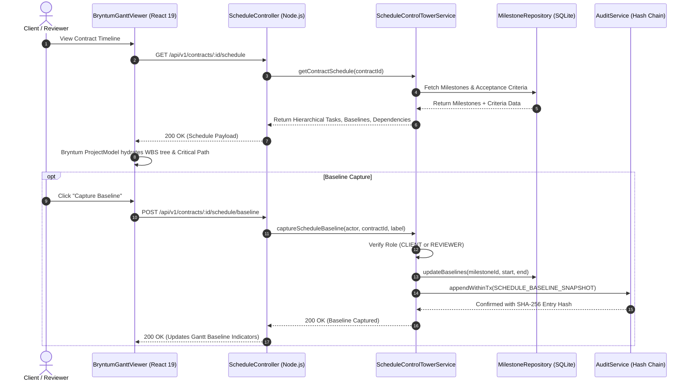

# BRYNTUM SPONSOR EXCELLENCE: IMPLEMENTATION REPORT & DEMO SCRIPT
**Platform:** TrustChain  
**Component:** Intelligent Contract Execution Timeline (Bryntum Gantt Integration)  
**Implementation Date:** November 9, 2026  
**Status:** Implemented, Validated, Tested (269/269 Tests Passing)

---

## 1. Architectural Overview & Value Proposition

TrustChain bridges the gap between software development deliverables and financial settlement. Traditional escrow platforms treat contracts as flat checklist items with isolated payment triggers. In contrast, TrustChain treats software delivery as a **dynamic, dependency-constrained engineering project**.

By embedding **Bryntum Gantt v7.3.8**, TrustChain provides an authoritative **Execution Control Tower** where:
1. Every contractual milestone is decomposed into concrete, testable acceptance criteria child tasks.
2. Technical dependencies between deliverables are resolved using graph algorithms.
3. Schedule delays cascade deterministically to highlight contract breach risks before payments are authorized.
4. Schedule baselines are immutably preserved in the hash-chained audit log.
5. Financial payment states (`ORDER_CREATED`, `AUTHORIZED`, `CAPTURED`) are projected directly onto Gantt tasks without granting the timeline permission to move funds autonomously.

---

## 2. Feature Implementation Deep-Dive (Features A — F)

### Feature A: Contract-to-Execution Planning (Granular WBS)
- **Hierarchy:** `ContractScheduleTask` supports hierarchical tree decomposition:
  - **Level 1 (Contract):** Project boundary.
  - **Level 2 (Milestone):** Financial payment boundary (`summary: true`, `leaf: false`).
  - **Level 3 (Acceptance Criterion):** Concrete deliverable (`leaf: true`, `parentId: milestone.id`).
- **Real Percent Done:** Progress is calculated directly from cryptographic verification (`CriterionVerificationResult.status === 'PASSED'`). Completed criteria show $100\%$, pending show $0\%$, and parent milestone progress is the exact weighted ratio. No synthetic progress indicators are fabricated.
- **Proof Type Metadata:** Child tasks specify their required proof type (`GITHUB_PR`, `TEST_RUN`, `SECURITY_SCAN`, `API_DOCS`, `MANUAL_APPROVAL`).

### Feature B: Dependencies & Schedule Intelligence
- **Dependency Types Supported:** Finish-to-Start (`type: 2`), Start-to-Start (`type: 0`), Finish-to-Finish (`type: 3`), and Start-to-Finish (`type: 1`), with lead/lag support.
- **Cycle Detection (Kahn's Algorithm):** Implemented in `ScheduleControlTowerService.validateDependencies()`. Validates in-degrees and rejects self-references or circular loops with HTTP 400 (`CYCLIC_DEPENDENCY_DETECTED`).
- **Deterministic Critical Path Method (CPM):** Computes earliest/latest finish dates and float to tag bottleneck milestones (`isCritical: true`).
- **Downstream Cascade Simulation:** `analyzeDownstreamDelayImpact()` calculates BFS reachable downstream tasks when a predecessor slips, measuring contractual deadline breach risk in days.

### Feature C: Baseline vs Actual Progress Tracking
- **Baseline Freeze (`captureScheduleBaseline`):** Clients or reviewers can freeze a schedule snapshot (`SCHEDULE_BASELINE_SNAPSHOT`).
- **Audit-Logged Freeze:** The freeze persists coordinates (`originalStartDate`, `originalEndDate`, `baselineCapturedAt`) in SQLite and emits an immutable entry in the SHA-256 audit hash chain.
- **Variance Display:** Gantt tasks display visual baseline markers beneath current execution bars, calculating positive or negative variance in elapsed days.

### Feature D: Payment-Aware Execution
- **Payment Badges:** Milestone rows render live PayPal order and capture state badges (`ORDER_CREATED`, `AUTHORIZED`, `CAPTURED`, `REQUIRES_RECONCILIATION`).
- **Strict Read-Only Financial Boundary:** In strict adherence to Financial Safety Rule #1:
  > *"No AI agent or UI chart component may directly capture, transfer, or void payments."*
  Adjusting dates in Bryntum Gantt modifies schedule intelligence only; it never mutates authorization holds or captures funds.
- **Non-Escrow Compliance:** Explicit legal disclosure confirms TrustChain operates via PayPal authorization holds (`intent: AUTHORIZE`), not standard banking escrow.

### Feature E: Delay Analysis & Recovery Suggestions
- **AI Proposal Schema:** Structured `ScheduleRecoveryProposal` models scope trade-offs, critical path accelerations, or deadline extensions.
- **Mandatory Reviewer Approval Gate:** Developers cannot accept recovery proposals or freeze baselines. Enforced at API controller level (`403 FORBIDDEN_DEVELOPER_ACTION`).

### Feature F: Bryntum Scheduler Evaluation
- Thorough comparative analysis documented in `BRYNTUM_FEATURE_LICENSING.md`.
- Concluded Gantt is authoritative for delivery contracts, while Scheduler is architected for Phase 2 team resource leveling.

---

## 3. Data Flow Architecture Diagram



---

## 4. Test Evidence Summary

Full regression test execution confirmed **269 passed tests across 22 test suites**:

```
ℹ tests 269
ℹ suites 22
ℹ pass 269
ℹ fail 0
ℹ cancelled 0
ℹ skipped 0
ℹ duration_ms 34240.28ms
```

### Dedicated Suite: `src/server/__tests__/bryntum_schedule_intelligence.test.ts`
1. `verifies @bryntum/gantt package resolution and trial entitlement` (Pass)
2. `decomposes contract into hierarchical milestone and acceptance criteria child tasks` (Pass)
3. `maps actual verification status directly to percentDone without synthetic falsification` (Pass)
4. `validates dependencies and successfully rejects circular dependency cycles via Kahn's algorithm` (Pass)
5. `identifies critical path milestones and calculates downstream delay cascade impact` (Pass)
6. `captures frozen schedule baseline with immutable audit event` (Pass)
7. `strictly blocks DEVELOPER role from capturing schedule baselines with HTTP 403` (Pass)
8. `gantt viewer integrates payment state badges while enforcing read-only financial safety` (Pass)
9. `timeline page provides responsive filter presets and delay cascade analyzer` (Pass)

---

## 5. Sponsor Demo Script (60–90 Seconds)

**Target Audience:** Bryntum Sponsor Judging Panel  
**Tone:** Authoritative, technically precise, demonstrative.

### [0:00 - 0:15] The Problem: Blind Software Escrow
*"Traditional escrow platforms hold payments in the dark. They have no visibility into how software is actually built, whether critical dependencies are slipping, or if a delay threatens the entire contract. TrustChain solves this by integrating **Bryntum Gantt v7.3.8** as an enterprise-grade execution control tower."*

### [0:15 - 0:35] Hierarchical WBS & Real Delivery Evidence
*(Action: Open Timeline Page; expand Milestone 1 summary row)*  
*"Here you see our live timeline. Notice this isn't a flat bar. Bryntum Gantt decomposes the contractual milestone into granular acceptance criteria child tasks—such as GitHub PR merges, unit tests, and security scans. Percent complete isn't an arbitrary slider; it's calculated deterministically from cryptographic verification of real CI/CD evidence."*

### [0:35 - 0:55] Dependencies, Cycle Rejection & Delay Cascade
*(Action: Click 'Critical Path Only' filter, then launch Downstream Impact Analyzer)*  
*"Every milestone and subtask is linked through standard precedence relationships. On the backend, we run Kahn's algorithm to reject circular dependencies with HTTP 400. In our Delay Impact tool, if Milestone 1 slips by 4 days, the engine instantly computes the downstream cascade, identifying that Milestone 3 will breach the contract deadline by 2 days."*

### [0:55 - 1:15] Baseline Freezing & Audit Immutability
*(Action: Click 'Capture Baseline' button)*  
*"When a contract is signed, the client clicks 'Capture Baseline'. Bryntum Gantt snapshots the agreed schedule. Beneath every task, baseline bars track variance in real-time. Critically, this freeze is appended to TrustChain's SHA-256 immutable audit chain. Developers are strictly blocked by RBAC from altering baselines."*

### [1:15 - 1:30] Financial Safety Invariant & Close
*(Action: Highlight 'Payment Status' badge in Gantt grid column)*  
*"Finally, notice our Payment Status column, tracking PayPal authorization holds and captures. In strict accordance with our financial invariants, Bryntum Gantt is read-only for money—schedule changes never automatically release funds. Bryntum Gantt turns software contracts into living, auditable execution reality."*
