# TrustChain — Gemini Fallback & Failure Recovery Report
**Document ID:** `TC-GEMINI-RECOVERY-003`  
**Security Classification:** Highly Confidential (Platform Resilience Architecture)  
**Status:** `VERIFIED_RESILIENT`  
**Execution Timestamp:** 2026-11-09T17:15:00.000Z  

---

## 1. Resilience Philosophy: Zero Fiduciary Interruption

In contract execution systems, high-availability of milestone verification is vital. If an upstream AI provider experiences transient latency spikes, HTTP 429 rate limit saturation, or unexpected 5xx gateway drops, the contract workflow must neither corrupt financial state nor leave milestones stuck in indeterminate `EVALUATING` states.

TrustChain implements a two-tier failure recovery architecture:
1. **Immediate Fail-Closed:** Critical security violations (e.g., `AI_FINANCIAL_BOUNDARY_VIOLATION`, `INVALID_GEMINI_API_KEY`) abort immediately, log an error, and safely roll back the milestone to `SUBMITTED`.
2. **Deterministic Fallback:** Transient upstream failures (e.g., `GEMINI_RATE_LIMITED`, `AI_EVALUATION_TIMEOUT`, `GEMINI_UNAVAILABLE`, `MALFORMED_AI_JSON`) automatically activate `DETERMINISTIC_FALLBACK` with explicit audit ledger logging and UI disclosure.

---

## 2. Failure Recovery Decision Tree

```mermaid
flowchart TD
    A["Invoke evaluateMilestone()"] --> B["Record EVALUATION_STARTED in SQLite Audit"]
    B --> C["Call Live Gemini Pipeline (Evidence, Risk, Arbitrator)"]
    C -->|Success HTTP 200| D["Return EvaluationRun with mode: LIVE_GEMINI"]
    C -->|Error Thrown| E{"Error Type Check"}
    
    E -->|"AI_FINANCIAL_BOUNDARY_VIOLATION or INVALID_GEMINI_API_KEY"| F["FAIL-CLOSED: Rollback to SUBMITTED + Re-throw Error"]
    
    E -->|"GEMINI_RATE_LIMITED, TIMEOUT, 503, or JSON_ERROR"| G{"Fallback Enabled?"}
    G -->|Yes| H["Activate DETERMINISTIC_FALLBACK"]
    G -->|No| F
    
    H --> I["Execute DeterministicMockEvaluator Heuristic Pipeline"]
    I --> J["Append Notice to Rationale & Observations"]
    J --> K["Record EVALUATION_FALLBACK_TRIGGERED in Audit Ledger"]
    K --> L["Record EVALUATION_COMPLETED with mode: DETERMINISTIC_FALLBACK"]
    L --> M["Return EvaluationRun with isMockEvaluation: true"]
    
    style D fill:#064e3b,stroke:#10b981,stroke-width:2px
    style F fill:#7f1d1d,stroke:#ef4444,stroke-width:2px
    style H fill:#78350f,stroke:#f59e0b,stroke-width:2px
    style K fill:#4c1d95,stroke:#8b5cf6,stroke-width:2px
```



---

## 3. Cryptographic Audit Ledger Provenance

When fallback is triggered, TrustChain preserves the complete chain of custody by appending a distinct cryptographic audit event:

```json
{
  "action": "EVALUATION_FALLBACK_TRIGGERED",
  "actorId": "reviewer_01",
  "actorRole": "REVIEWER",
  "entityType": "EVALUATION",
  "entityId": "eval_8902c401fe2a",
  "contractId": "contract_seed_01",
  "milestoneId": "ms_seed_01",
  "previousState": "EVALUATING",
  "newState": "EVALUATING",
  "payload": {
    "submissionId": "sub_seed_01",
    "originalMode": "LIVE_GEMINI",
    "fallbackMode": "DETERMINISTIC_FALLBACK",
    "errorCode": "GEMINI_RATE_LIMITED",
    "errorMessage": "Gemini API rate limit or quota exceeded (credentials redacted)."
  },
  "entryHash": "e3b0c44298fc1c149afbf4c8996fb92427ae41e4649b934ca495991b7852b855",
  "previousHash": "a1b2c3d4e5f6...",
  "sequenceNumber": 14
}
```

Audit Replay Engine (`AuditReplayService.ts`) recognizes `EVALUATION_FALLBACK_TRIGGERED` as a valid immutable lifecycle event, ensuring zero replay failures or state inconsistencies.

---

## 4. Bounded Retry Mechanics

To absorb transient network jitter without exceeding client timeouts, `callGeminiJson` in `EvaluationService.ts` implements a bounded 1-shot retry for specific transient failures:
- Target statuses: HTTP 503 (Service Unavailable) and connection resets.
- Exponential backoff: 800ms jittered delay before the single retry.
- Total maximum pipeline latency budget: 25,000ms.
- Full credential redaction: In case of error output, the API key is never surfaced in logs or exception messages.
