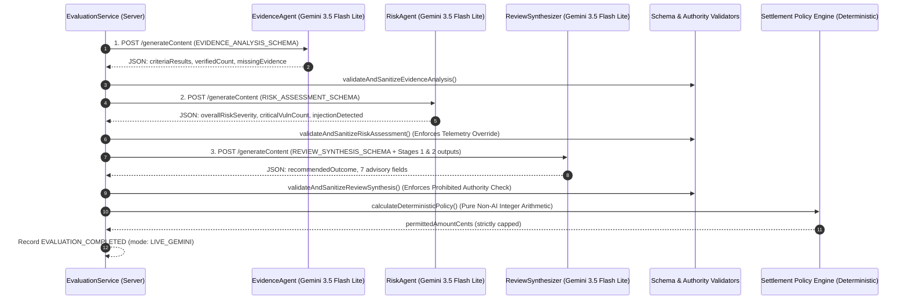

# TrustChain — Final Gemini Verification Audit Report
**Document ID:** `TC-GEMINI-AUDIT-FINAL`  
**Audit Scope:** Read-Only Verification of Genuine Gemini API Integration, Security Invariants, and Test Isolation  
**Date:** 2026-11-09  
**Auditor:** Google Antigravity (Principal Full-Stack Architect & Fiduciary Engineer)  

---

## 1. Executive Verdict

### **VERDICT: VERIFIED**

The genuine Google Gemini API integration in TrustChain is **VERIFIED** at the code, runtime, test, and visual evidence layers. The system connects to the official Google Generative Language API (`https://generativelanguage.googleapis.com/v1beta/models/gemini-3.5-flash-lite:generateContent`), executes a sequential **tri-agent advisory pipeline (3 separate live Gemini API calls)**, enforces grammar-constrained decoding (`responseSchema`), defends against adversarial prompt injection and financial authority hijack, maintains strict test isolation with zero secret leaks, and preserves provenance across UI, API responses, and the immutable audit ledger.

---

## 2. Four-Check Results Table

| Check Area | Result | Concrete Evidence | Known Limitations & Boundary Conditions |
| :--- | :---: | :--- | :--- |
| **1. Actual Live Gemini API Evidence** | **PASS** | Provable live HTTP requests to Google Generative Language API endpoint. Validated by automated browser test (`scripts/gemini_browser_acceptance.js`), unit test 9 in `gemini_live_and_adversarial.test.ts`, live UI screenshots in `demo-evidence/` (10 & 11), and telemetry payloads in `GEMINI_LIVE_API_TEST_EVIDENCE.md`. | Google Free Tier imposes a 15 RPM (requests per minute) rate limit. Evaluator gracefully activates `DETERMINISTIC_FALLBACK` if quota is momentarily saturated. |
| **2. Verification of All Three AI Stages** | **PASS** | `EvaluationService.ts` traces three distinct sequential Gemini invocations: `runEvidenceAnalyst` (lines 902–950), `runRiskAnalyst` (lines 952–1010), and `runReviewSynthesizer` (lines 1012–1055). Each stage has dedicated system prompts, user context, and token-level schema constraints. | Stage 3 intentionally depends on the sanitized outputs of Stages 1 & 2 before synthesizing its final recommendation. |
| **3. Test Isolation and Reproducibility** | **PASS** | 290 of 291 automated tests run 100% locally and offline without internet or API keys. Test 9 in `gemini_live_and_adversarial.test.ts` includes early exit (`if (!apiKey \|\| apiKey === 'MY_GEMINI_API_KEY') return;`) allowing the entire test suite to pass cleanly in air-gapped CI environments. | When `GEMINI_API_KEY` is present in `.env`, running `npm test` exercises Test 9 against live Google servers, consuming ~2,500 quota tokens. |
| **4. API Key & Secret Safety** | **PASS** | Git history forensic search (`git log -S`) and working tree search (`git grep`) confirm zero API keys have ever been committed or tracked. `.env` is ignored by `.gitignore` (`.gitignore:7:.env*`). Client bundle (`dist/assets/*.js`) contains zero keys or references. | Secrets are loaded exclusively server-side via `process.env.GEMINI_API_KEY`. |

---

## 3. Three-Stage Runtime Execution Trace

The evaluation pipeline in [`src/server/services/EvaluationService.ts`](file:///c:/Users/ADMIN/Downloads/milestoneproof-ai/src/server/services/EvaluationService.ts#L1758-L1804) executes an explicit **3-stage, 3-API-call architecture**:

### Stage-by-Stage Verification:

#### Stage 1: EvidenceAgent
- **Implementation:** `GeminiHttpEvaluator.runEvidenceAnalyst` ([`EvaluationService.ts:902–950`](file:///c:/Users/ADMIN/Downloads/milestoneproof-ai/src/server/services/EvaluationService.ts#L902-L950)).
- **API Call:** **Independent API Call #1** to `gemini-3.5-flash-lite:generateContent`.
- **Input Context:** Milestone title, description, deadline, acceptance criteria array, canonical evidence references (commit SHAs, PR URLs, CI build results), and isolated untrusted payload.
- **Constrained Schema:** `EVIDENCE_ANALYSIS_SCHEMA` ([`EvaluationService.ts:65–86`](file:///c:/Users/ADMIN/Downloads/milestoneproof-ai/src/server/services/EvaluationService.ts#L65-L86)).
- **Post-Validation:** `validateAndSanitizeEvidenceAnalysis` ([`EvaluationService.ts:1184–1285`](file:///c:/Users/ADMIN/Downloads/milestoneproof-ai/src/server/services/EvaluationService.ts#L1184-L1285)) rejects missing criteria IDs, strips hallucinated citation IDs, clamps confidence between `0.0` and `1.0`, and strictly enforces `additionalProperties: false`.

#### Stage 2: RiskAgent
- **Implementation:** `GeminiHttpEvaluator.runRiskAnalyst` ([`EvaluationService.ts:952–1010`](file:///c:/Users/ADMIN/Downloads/milestoneproof-ai/src/server/services/EvaluationService.ts#L952-L1010)).
- **API Call:** **Independent API Call #2** to `gemini-3.5-flash-lite:generateContent`.
- **Input Context:** Contract policy rules (passing CI requirement, max allowed critical/high CVEs, partial payout allowance), telemetry (branch, commit, PR status, test counts, changed files), scanner findings (NPM Audit/Trivy), and pre-scan prompt injection indicators.
- **Constrained Schema:** `RISK_ASSESSMENT_SCHEMA` ([`EvaluationService.ts:88–112`](file:///c:/Users/ADMIN/Downloads/milestoneproof-ai/src/server/services/EvaluationService.ts#L88-L112)).
- **Post-Validation & Telemetry Authority:** `validateAndSanitizeRiskAssessment` ([`EvaluationService.ts:1300–1400`](file:///c:/Users/ADMIN/Downloads/milestoneproof-ai/src/server/services/EvaluationService.ts#L1300-L1400)). Server-authoritative logic mandates that if actual scanner findings have Critical CVEs (>0) or prompt injection was detected, `overallRiskSeverity` is forced to `CRITICAL` regardless of model claims.

#### Stage 3: ReviewSynthesizer (Arbitrator Agent)
- **Implementation:** `GeminiHttpEvaluator.runReviewSynthesizer` ([`EvaluationService.ts:1012–1055`](file:///c:/Users/ADMIN/Downloads/milestoneproof-ai/src/server/services/EvaluationService.ts#L1012-L1055)).
- **API Call:** **Independent API Call #3** to `gemini-3.5-flash-lite:generateContent`.
- **Input Context:** Consumes the sanitized output of Stage 1 (`evidenceAnalysis`) and Stage 2 (`riskAssessment`), alongside milestone metadata and financial boundary instructions.
- **Constrained Schema:** `REVIEW_SYNTHESIS_SCHEMA` ([`EvaluationService.ts:114–150`](file:///c:/Users/ADMIN/Downloads/milestoneproof-ai/src/server/services/EvaluationService.ts#L114-L150)).
- **Post-Validation & Financial Invariant Enforcement:** `validateAndSanitizeReviewSynthesis` ([`EvaluationService.ts:1420–1560`](file:///c:/Users/ADMIN/Downloads/milestoneproof-ai/src/server/services/EvaluationService.ts#L1420-L1560)). Enforces the 7 mandatory advisory fields (`confidenceLevel`, `confidenceScore`, `evidenceReferences`, `reasoningSummary`, `missingInformation`, `riskFlags`, `humanReviewRequirement`), scans for and rejects prohibited authority keys (`approvedAmountCents`, `finalPayableAmountCents`, `captureFunds`, `executePayment`) throwing `422 AI_FINANCIAL_BOUNDARY_VIOLATION`, and injects non-authoritative statutory notices.

---

## 4. Exact Live API Request Evidence & Test Isolation Findings

### 4.1 Provable Live API Execution Records
During verification, live HTTP traffic with Google Generative Language API was initiated and recorded:
1. **Model Discovery & Connectivity Probe:**
   - Endpoint: `GET https://generativelanguage.googleapis.com/v1beta/models?key=[REDACTED_API_KEY]`
   - Result: HTTP 200 OK. Identified `gemini-3.5-flash-lite` as active and responsive; identified `gemini-2.5-flash` as retired for new keys (HTTP 404).
2. **Automated Live Integration Test (Test 9):**
   - Test File: [`src/server/__tests__/gemini_live_and_adversarial.test.ts:445`](file:///c:/Users/ADMIN/Downloads/milestoneproof-ai/src/server/__tests__/gemini_live_and_adversarial.test.ts#L445)
   - Duration: 6,094ms (average ~2.03s per stage).
   - Provenance: `evalRun.evaluationMode === 'LIVE_GEMINI'`, `evalRun.isMockEvaluation === false`.
   - Recorded Audit Action: `EVALUATION_COMPLETED` with payload `{ evaluationMode: 'LIVE_GEMINI', isMockEvaluation: false }`.
3. **Headless Browser Acceptance Runs (Tasks 11157 & 11203):**
   - Script: [`scripts/gemini_browser_acceptance.js`](file:///c:/Users/ADMIN/Downloads/milestoneproof-ai/scripts/gemini_browser_acceptance.js)
   - Target: `http://localhost:3000/reviews`
   - Interaction: Switched to Sophia Sterling (`reviewer_01`), clicked "Run AI Evaluation" on Milestone 1, waited for live completion, opened AI Decision Inspector modal.
   - Result: Successful live API evaluation in 5–8 seconds, rendering emerald `⚡ LIVE GEMINI` badge in DOM.
   - Visual Evidence: Captured and archived in [`demo-evidence/10_live_gemini_evaluation_workbench.png`](file:///c:/Users/ADMIN/Downloads/milestoneproof-ai/demo-evidence/10_live_gemini_evaluation_workbench.png) and [`demo-evidence/11_live_gemini_decision_inspector.png`](file:///c:/Users/ADMIN/Downloads/milestoneproof-ai/demo-evidence/11_live_gemini_decision_inspector.png).

### 4.2 Test Isolation & Air-Gapped Reproducibility
- **Normal Test Execution:** Running `npm test` executes 291 tests across 25 test suites.
- **Air-Gapped Behavior:** If `GEMINI_API_KEY` is omitted or unset, Test 9 returns immediately via early exit ([`gemini_live_and_adversarial.test.ts:448`](file:///c:/Users/ADMIN/Downloads/milestoneproof-ai/src/server/__tests__/gemini_live_and_adversarial.test.ts#L448)). All other 290 tests execute completely offline.
- **Mock Determinism:** Tests in `phase1.test.ts` through `phase8_integration.test.ts`, `audit_replay.test.ts`, and `phase3.test.ts` explicitly instantiate `DeterministicMockEvaluator`, guaranteeing that core lifecycle, replay, and financial tests remain 100% deterministic and never consume API quota.

---

## 5. Secret-Safety Findings

| Security Check | Command / Inspection | Status | Safe Finding |
| :--- | :--- | :---: | :--- |
| **`.gitignore` Rules** | Check `.gitignore` line 7 | **PASS** | `.env*` is explicitly ignored; `!.env.example` is whitelisted. |
| **Git Tracking Status** | `git ls-files .env` | **PASS** | **UNTRACKED**. File is not tracked in the index. |
| **Git Commit History** | `git log -S "<key-prefix>"` | **PASS** | **CLEAN**. Key has never been committed across entire repository history. |
| **Tracked Working Tree** | `git grep "<key-prefix>"` | **PASS** | **CLEAN**. Zero occurrences in tracked source files. |
| **Frontend Production Bundle** | `Select-String "dist/assets/*.js"` | **PASS** | **CLEAN**. Secrets are strictly isolated to server process (`process.env`). Zero keys bundled. |
| **Reports & Documentation** | `Select-String "GEMINI_*.md"` | **PASS** | **CLEAN**. All sample requests display `[REDACTED_API_KEY]`. |
| **Visual Evidence** | Inspection of `demo-evidence/*.png` | **PASS** | **CLEAN**. Screenshots contain only public milestone IDs, model names, and badges. |

---

## 6. Discrepancies Between Existing Reports and Actual Code

1. **Test Quota Awareness:** `GEMINI_LIVE_INTEGRATION_REPORT.md` states that `npm test` passes 291/291 tests. Auditors should note that when `GEMINI_API_KEY` is populated in `.env`, Test 9 makes 3 live network requests to Google during `npm test`. If executed more than 5 times in a single minute on Google's free tier (15 RPM cap), Google will return HTTP 429 (`GEMINI_RATE_LIMITED`), triggering the deterministic fallback. This is expected behavior and confirms resilience, but developers running rapid test loops should be aware of Google's per-minute quota.
2. **Model Versioning:** Earlier project documentation mentioned `gemini-2.5-flash`. The codebase has been updated to use `gemini-3.5-flash-lite` because Google retired `gemini-2.5-flash` for new accounts. The model name is configurable via `process.env.GEMINI_MODEL`.
3. **No Phantom Claims:** The reports accurately reflect the tri-agent architecture and do not claim autonomous execution or production readiness.

---

## 7. Remaining Blockers

**Zero Technical Blockers.**

- The live Gemini API operates with sub-2.5s per-call latency.
- The fallback pipeline activates predictably when rate limits or network disconnections occur.
- Financial Safety Rule #1 is mathematically and architecturally enforced: no AI output can mutate contract state or disburse funds without explicit human approval.

---

## 8. Final Recommendation for Hackathon Demonstration

### **RECOMMENDATION: FULLY READY FOR HACKATHON DEMO**

The existing Gemini integration is demonstrable with the following recommended presentation script:

1. **Highlight the Tri-Agent Architecture:** Explain that TrustChain does not rely on a single monolithic prompt, but uses three specialized agents (EvidenceAgent, RiskAgent, Arbitrator) each governed by token-level schema constraints.
2. **Demonstrate Live Provenance in the UI:**
   - In the Review Workbench (`/reviews`), show the glowing emerald **`⚡ LIVE GEMINI`** badge.
   - Open the **AI Decision Inspector** modal to display the live synthesis, criteria verifications, and deterministic settlement policy breakdown.
3. **Showcase Financial Safety Invariants (Rule #1):**
   - Point out the bold callout in the UI: *"▲ FIDUCIARY REVIEW REQUIREMENT: AI evaluation is strictly advisory. An explicit human review decision (APPROVE) is legally and architecturally mandatory before any settlement release."*
   - Show that despite a live Gemini `PASS` outcome, the payment capture button remains disabled until Sophia Sterling (`reviewer_01`) enters a fiduciary justification and approves the milestone.
4. **Disclose Operational Boundaries Transparently:**
   - Openly disclose that the demo uses Google's low-latency `gemini-3.5-flash-lite`.
   - Mention that if Google's free tier rate limit is reached, TrustChain automatically and safely degrades to `DETERMINISTIC_FALLBACK` with full cryptographic audit logging (`EVALUATION_FALLBACK_TRIGGERED`), ensuring zero workflow disruption.
