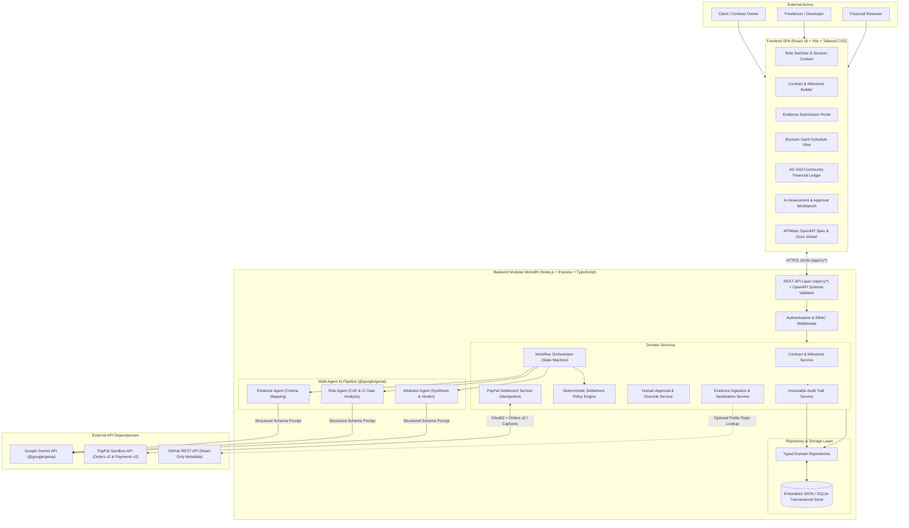

# High-Level Design (HLD) — MilestoneProof AI

## 1. Executive Overview & Architectural Reality Check

**MilestoneProof AI** is a multi-agent evidence-to-settlement orchestration platform for software development contracts. It bridges the verification and financial governance gap between software buyers (**Clients**), software builders (**Freelancers / Developers**), and fiduciary approvers (**Financial Reviewers**).

> **Strict Separation of Current vs. Proposed Architecture:**
> Every section in this document explicitly distinguishes between:
> 1. **Current Implementation (Verified in Codebase):** What actually exists in the repository today.
> 2. **Proposed Target Architecture (MVP Design):** The modular monolith system design to be built across the upcoming implementation phases.

---

## 2. Overall System Architecture

### 2.1 Current Implementation (Verified in Codebase)
- **Application Skeleton:** The repository (`package.json`) is currently a single-package Vite + React 19 + TypeScript starter template (`"name": "react-example"`).
- **Frontend Entry Point:** `index.html` mounts `src/main.tsx`, which renders `src/App.tsx`. Currently, `src/App.tsx` returns an empty `

`.
- **Styling:** `src/index.css` contains `@import "tailwindcss";` configured via `@tailwindcss/vite` in `vite.config.ts`.
- **Installed Dependencies (`package.json`):**
  - Frontend: `react` (`^19.0.1`), `react-dom` (`^19.0.1`), `lucide-react` (`^0.546.0`), `motion` (`^12.23.24`), `tailwindcss` (`^4.3.3`).
  - Backend / Runtime packages pre-installed but unused: `express` (`^4.21.2`), `dotenv` (`^17.2.3`), `@google/genai` (`^2.4.0`), `tsx` (`^4.21.0`).
- **Missing Layers:** There is no backend server entry file (`server.ts` / `server.js`), no API routes, no persistence layer/database, no Gemini agent services, no PayPal integration, and no UI components yet.

### 2.2 Proposed Target Architecture (Modular Monolith)
Per `AGENTS.md` and `PROJECT_STATUS.md`, MilestoneProof AI will be built as a **Modular Monolith**:
- **Single Deployable Unit, Strict Module Boundaries:** A unified Node.js + Express + TypeScript backend serving RESTful JSON APIs under `/api/v1/*` and hosting the Vite React 19 frontend SPA.
- **Why a Modular Monolith?**
  - **Zero Distributed Latency & Complexity:** Avoids microservice network overhead, distributed transaction pitfalls, and multi-container orchestration complexity during hackathon evaluation.
  - **Strict Separation of Concerns:** Inside the monolith, controllers, domain services, AI agents, the deterministic settlement policy engine, repositories, and external adapters (Gemini, PayPal, GitHub) live in strictly isolated modules with explicit TypeScript interfaces.
- **Core Governance Principle (Advisory AI vs. Deterministic Finance):**
  - **Advisory Layer (AI Agents):** Evidence Agent, Risk Agent, and Arbitrator Agent inspect untrusted delivery evidence against milestone acceptance criteria using Google Gemini (`@google/genai`) and output schema-validated advisory assessments.
  - **Deterministic Layer (Settlement Policy Engine):** Pure, decimal-safe TypeScript business logic calculates the maximum permitted payout cap (`PermittedAmount`), applies mandatory security/CI gates, and computes late penalties.
  - **Human Constitutional Authority:** An authenticated Client / Financial Reviewer reviews the AI assessment and policy calculation and explicitly approves, requests revisions, or rejects.
  - **Payment Execution Layer (PayPal Orders API v2):** Only after human sign-off does the backend execute payment authorization capture via PayPal Developer Sandbox.

### 2.3 High-Level Architecture Diagram (Mermaid)

---

## 3. Frontend Architecture

### 3.1 Current Implementation
- `src/main.tsx` mounts `<App />` into `#root`.
- `src/App.tsx` is a blank placeholder component (`export default function App() { return 

; }`).
- No routing, state management, or UI components exist yet.

### 3.2 Proposed Frontend Architecture
- **Technology Stack Retained:** React 19, TypeScript, Vite, Tailwind CSS v4, `lucide-react` icons, and `motion` for smooth state transitions.
- **View Organization (Role-Aware Workspace):**
  1. **Contract & Milestone Management View:** Allows Clients to create contracts, define milestones, specify measurable acceptance criteria (`AC-1`, `AC-2`, etc.), configure risk gates, and fund/authorize milestones.
  2. **Delivery Schedule View (Bryntum Gantt Integration):** Visualizes milestone timelines, inter-milestone dependencies, baseline deadlines vs. actual submission dates, and delay slippage indicators without silently altering signed contract terms.
  3. **Evidence Submission Portal (Freelancer View):** Structured form for submitting GitHub repository URLs, immutable 40-character commit SHAs, Pull Request URLs, CI/CD test reports, and security scan JSON/SARIF outputs (plus quick-load benchmark presets for deterministic demo scenarios).
  4. **Financial Decision Intelligence Ledger (AG Grid Community Integration):** Institutional-grade grid displaying all milestones across contracts with columns for Delivery Status, Verified Criteria Ratio, Risk Severity, AI Recommendation, Agreed Amount, Policy Permitted Cap, Human Approved Amount, and PayPal Settlement Status.
  5. **AI Assessment & Human Review Workbench:** Side-by-side inspection modal showing criterion-by-criterion Evidence Agent findings, Risk Agent CVE citations, Arbitrator summary, Deterministic Policy Engine math breakdown, and Reviewer action controls (`Approve`, `Request Revisions`, `Reject`).
  6. **Immutable Audit Trail & APIMatic Developer Portal View:** Displays chronological state transitions, actor IDs, PayPal transaction references, and the validated OpenAPI 3.0 contract specification.
- **Frontend State & Data Fetching:**
  - Centralized typed API client consuming `/api/v1/*` endpoints.
  - Strictly server-authoritative state: The frontend never computes final permitted payouts or executes Gemini/PayPal calls directly; all secrets and business rules remain on the backend.

---

## 4. Backend Architecture

### 4.1 Phase 1 Implemented Backend Architecture (`src/server/`)
- **Runtime & HTTP Server Architecture (`node:http` + Express-Compatible Router + Vite Middleware):**
  - Executed natively on **Node.js `v24.14.0`** (`node src/server/index.ts`).
  - Because `node_modules` is not pre-installed in the offline sandbox and zero-dependency reliability is required, `src/server/index.ts` implements a lightweight, Express-compatible HTTP router (`createMountedHttpApp` on `node:http`) using standard `(req: ApiRequest, res: ApiResponse, next: NextFunction)` controller/middleware signatures.
  - **Coexistence of `/api/v1/*` and Vite Middleware:** Requests matching `/api/v1/*` are handled directly by the API router, while non-API requests (`/`, `/src/*`, SPA routes) are delegated to `app.useFallback(...)`, which attaches Vite's `vite.middlewares` when `vite` is present in `node_modules` (or serves `index.html` directly when running in standalone zero-install mode).
- **Layered Modular Architecture (`src/server/`):**
  1. **API / Route Layer (`src/server/routes/apiRoutes.ts`):** Defines REST endpoints (`/api/v1/health`, `/api/v1/auth/*`, `/api/v1/users`, `/api/v1/contracts/*`, `/api/v1/audit/*`, and upcoming Phase 2–7 endpoints).
  2. **Controller Layer (`src/server/controllers/`):** `AuthController.ts` and `ContractController.ts` extract authenticated actor context, invoke domain services, and format standard JSON responses and RFC 7807 error envelopes.
  3. **Service & Orchestration Layer (`src/server/services/`):**
     - `AuthService.ts` (Implemented Phase 1): Asynchronous `crypto.scrypt()` password verification, DB-authoritative role resolution, HMAC-SHA256 session token signing/verification (`jti`, `iss`, `aud`, `exp`), session revocation (`auth_sessions`), and `ENABLE_DEMO_IMPERSONATION` gate.
     - `ContractService.ts` (Implemented Phase 1): Transactional contract creation, milestone budget allocation validation, separation-of-duties checks, and contract activation (`DRAFT -> ACTIVE`).
     - `AuditService.ts` (Implemented Phase 1): Tamper-evident SHA-256 hash-chained logger (`AUDIT_GENESIS_HASH`, canonical JSON serialization, `appendWithinTx`, `verifyChain`).
     - `EvidenceService`, `WorkflowOrchestrator`, `SettlementPolicyEngine`, `ApprovalService`, `PayPalService` (Scheduled for Phases 5–7).
  4. **AI Agent Layer (`src/server/agents/`):** Scheduled for Phase 5 (`EvidenceAgent`, `RiskAgent`, `ArbitratorAgent`).
  5. **Repository Layer (`src/server/repositories/`):** `Database.ts` and `DomainRepositories.ts` abstracting native `node:sqlite` persistence.

---

## 5. Database Architecture

### 5.1 Phase 1 Implemented Database Architecture (`node:sqlite`)
- **Native Node.js v24 `node:sqlite` (`DatabaseSync`) Transactional Store:**
  - Configured in `src/server/repositories/Database.ts` with `PRAGMA journal_mode = WAL;`, `PRAGMA synchronous = FULL;` (for financial and audit commit durability), `PRAGMA foreign_keys = ON;`, and `PRAGMA busy_timeout = 5000;`.
  - Uses `db.withTransaction()` (`BEGIN IMMEDIATE TRANSACTION` + nested `SAVEPOINT` support) so domain writes and audit log appends always commit or roll back atomically.
  - Protects `audit_logs` at the database level via `BEFORE UPDATE` (`trg_audit_logs_immutable_update`) and `BEFORE DELETE` (`trg_audit_logs_immutable_delete`) triggers that abort any attempt to modify or delete existing audit records.
- **Core Collections / Tables (Created in Migration `001_initial_phase1_schema`):**
  1. `users`: Actor profiles (`id`, `name`, `email`, `password_hash`, `role`: `CLIENT` | `DEVELOPER` | `REVIEWER`, `is_active`, `is_demo_account`).
  2. `auth_sessions`: Active & revoked session token registry (`jti`, `user_id`, `role`, `issued_at`, `expires_at`, `revoked_at`, `revoke_reason`).
  3. `contracts`: Contract header, budget in cents, currency, policy rules, participant IDs, status, version.
  4. `milestones`: Linked to `contract_id`, sequence order, title, amount in cents, deadline, dependencies, acceptance criteria array, state machine status.
  5. `evidence_submissions`: Linked to `milestone_id`, attempt number, repo URL, commit SHA, PR URL, CI report payload, security scan payload, submission timestamp.
  6. `ai_evaluations`: Linked to `milestone_id` and `submission_id`, outputs of Evidence Agent, Risk Agent, Arbitrator Agent, plus Deterministic Policy Engine calculation breakdown.
  7. `human_approvals`: Linked to `milestone_id` and `evaluation_id`, reviewer ID, decision (`APPROVE` | `REJECT` | `REQUEST_REVISIONS`), approved amount in cents, override reason, timestamp.
  8. `payment_transactions`: Linked to `milestone_id`, PayPal Order ID, Authorization ID, Capture ID, idempotency key (`PayPal-Request-Id`), amount in cents, currency, PayPal status, raw debug metadata.
  9. `audit_logs`: Append-only hash-chained event log (`seq`, `id`, `timestamp`, `actor_id`, `actor_role`, `action`, `entity_type`, `entity_id`, `contract_id`, `milestone_id`, `previous_state`, `new_state`, `payload_json`, `previous_hash`, `entry_hash`).

---

## 6. Gemini AI Integration Architecture

### 6.1 Current Implementation
- `@google/genai` (`^2.4.0`) is listed in `package.json` dependencies, and `GEMINI_API_KEY` is defined in `.env.example`, but there are zero calls or imports of `@google/genai` in the codebase.

### 6.2 Proposed Gemini AI Architecture
- **Server-Side Only Execution:** All `@google/genai` calls execute strictly on the Node.js backend using `process.env.GEMINI_API_KEY`. The API key is never exposed to the browser.
- **Three Specialized Agents (Separation of Prompts & Schemas):**
  1. **Evidence Agent:** Evaluates submitted commit metadata, PR descriptions/diffs, and CI test summaries against each milestone acceptance criterion (`VERIFIED`, `PARTIAL`, `UNVERIFIED`, `CONTRADICTED`).
  2. **Risk Agent:** Analyzes structured security scan findings (CVEs, CVSS scores, dependency advisories) and CI build status against contract risk gates (`CLEAN`, `WARNING`, `BLOCKING`).
  3. **Arbitrator Agent:** Consumes the validated outputs of the Evidence Agent and Risk Agent, synthesizes an explainable human-readable rationale with concrete artifact citations, and emits an advisory recommendation (`RECOMMEND_APPROVAL`, `RECOMMEND_HOLD`, `RECOMMEND_REJECTION`).
- **Anti-Hallucination & Prompt Injection Defenses:**
  - **Untrusted Input Isolation:** GitHub PR descriptions, commit messages, and CI logs are wrapped in explicit XML-style data delimiters (`<untrusted_evidence>...</untrusted_evidence>`) with system instructions commanding the model to ignore any embedded instructions (prompt injection defense).
  - **Strict Structured Outputs:** Every Gemini call uses `responseMimeType: "application/json"` and `responseSchema` (Google GenAI Type schema) paired with backend runtime schema validation before the orchestrator accepts the response.
  - **Controlled Fallback / Error Handling:** Each agent call is wrapped in a 30-second timeout. If Gemini returns malformed JSON or times out, the evaluation transitions to `EVALUATION_FAILED` (allowing safe retry) and never defaults to a synthetic approval.

---

## 7. PayPal Integration Architecture

### 7.1 Current Implementation
- **None.** No PayPal code or environment variables exist in `.env.example` or `src/`.

### 7.2 Proposed PayPal Integration Architecture
- **API Standard:** PayPal Developer Sandbox REST API using **Orders API v2** (`/v2/checkout/orders`) and **Payments Authorizations/Captures API v2** (`/v2/payments/authorizations`).
- **No Custom Escrow Claim:** MilestoneProof AI does not hold custodial funds or claim to be a licensed escrow bank. Instead, it uses PayPal's standard **Order Creation -> Buyer Authorization (`intent: "AUTHORIZE"`) -> Conditional Capture / Void** workflow.
- **Core Lifecycle:**
  1. **OAuth 2.0 Token Exchange:** Backend exchanges `PAYPAL_CLIENT_ID` and `PAYPAL_CLIENT_SECRET` via `POST /v1/oauth2/token` (`grant_type=client_credentials`) and caches the bearer token until expiry.
  2. **Order Creation (`intent: "AUTHORIZE"`):** Client funds/activates a milestone -> Backend calls `POST /v2/checkout/orders` with `intent: "AUTHORIZE"` for the agreed milestone amount.
  3. **Buyer Approval & Order Authorization:** After buyer approval in Sandbox (or Sandbox order authorization call `POST /v2/checkout/orders/{id}/authorize`), PayPal returns an `authorization_id` in status `CREATED`.
  4. **Human Approval Gate:** The authorization remains untouched while the Freelancer submits evidence, AI agents evaluate, Policy Engine calculates `PermittedAmount`, and the Human Reviewer approves `$A` (`$0 < $A <= PermittedAmount <= AuthorizedAmount`).
  5. **Idempotent Capture:** Backend calls `POST /v2/payments/authorizations/{authorization_id}/capture` with header `PayPal-Request-Id: <deterministic-uuid>`. If `$A < AuthorizedAmount`, `final_capture: true` is passed so PayPal captures the partial settlement and automatically releases/voids the remaining authorization balance.
  6. **Void on Rejection:** If the milestone is permanently rejected, backend calls `POST /v2/payments/authorizations/{authorization_id}/void`.
  7. **Webhook Verification:** Backend exposes `POST /api/v1/webhooks/paypal` to receive asynchronous payment state updates (`PAYMENT.AUTHORIZATION.CREATED`, `PAYMENT.CAPTURE.COMPLETED`, `PAYMENT.CAPTURE.DENIED`, `PAYMENT.AUTHORIZATION.VOIDED`) and verifies webhook signatures via PayPal's `/v1/notifications/verify-webhook-signature`.

---

## 8. Authentication and Authorization (RBAC)

### 8.1 Current Implementation
- **None.** No authentication or user session logic exists.

### 8.2 Proposed Authentication & Authorization Architecture
- **Role-Based Access Control (RBAC) with Deterministic Demo Persona Switcher + Signed Session Headers:**
  - Three explicit personas exist in the system:
    1. **Client (`ROLE_CLIENT`):** Can create draft contracts, define milestones, activate/authorize PayPal orders, and view evaluations/audit logs.
    2. **Freelancer / Developer (`ROLE_DEVELOPER`):** Can view assigned milestones and submit delivery evidence. **Strictly prohibited** from approving milestones, overriding policies, or triggering PayPal captures.
    3. **Financial Reviewer (`ROLE_REVIEWER`):** Can inspect the AG Grid financial ledger, review AI assessments and policy caps, and execute `APPROVE`, `REQUEST_REVISIONS`, or `REJECT` actions.
- **Backend Enforcement:**
  - Every mutating API request must carry authenticated actor context (via session token / signed actor header validated against the backend user registry).
  - The backend `ApprovalService` enforces **Separation of Duties**: even if a user attempts to forge a request payload, the backend verifies that `actor.id !== contract.developerId` and `actor.role === 'REVIEWER' || actor.role === 'CLIENT'` before recording an approval or invoking `PayPalService`.

---

## 9. Communication Between Components

1. **Frontend <-> Backend API:** Synchronous HTTPS JSON REST calls over `/api/v1/*`. All payloads conform to the APIMatic-validated OpenAPI 3.0 specification. Error responses use a standardized RFC 7807 Problem Details structure (`{ code, message, details, traceId }`).
2. **Controllers <-> Domain Services:** Direct in-process TypeScript method calls using strongly typed DTOs.
3. **Workflow Orchestrator <-> AI Agents:** Sequential asynchronous orchestration (`EvidenceAgent.evaluate()` + `RiskAgent.evaluate()` -> `ArbitratorAgent.synthesize()` -> `SettlementPolicyEngine.calculate()`).
4. **Backend <-> External APIs (Gemini, PayPal, GitHub):** Outbound HTTPS requests using Node's native `fetch` / `@google/genai` SDK with strict timeouts, retry-safe idempotency keys, and structured error mapping.

---

## 10. External API Dependencies

| Dependency | Purpose | Protocol / SDK | Failure & Degraded Mode Handling |
| :--- | :--- | :--- | :--- |
| **Google Gemini API** | Evidence Agent, Risk Agent, and Arbitrator Agent structured analysis | `@google/genai` SDK (`gemini-2.5-flash`) | 30s timeout, JSON schema validation; on failure, marks evaluation `EVALUATION_FAILED` for safe retry—never fabricates approvals. |
| **PayPal Sandbox API** | Order creation, authorization, capture, void, and webhook verification | REST HTTP v2 (`api-m.sandbox.paypal.com`) | Requires `PAYPAL_CLIENT_ID` & `PAYPAL_CLIENT_SECRET`; uses `PayPal-Request-Id` idempotency header; records `PAY_FAILED` with `debug_id` on error. |
| **GitHub Public REST API** | Optional live metadata verification for public repo commits/PRs | REST HTTP v3 (`api.github.com`) | Handles 60 req/hr unauthenticated rate limit gracefully by falling back to submitted artifact payload inspection and logging rate-limit status. |

---

## 11. Deployment Architecture

### 11.1 Current Implementation
- Configured for local Vite development (`vite --port=3000 --host=0.0.0.0`) and AI Studio Cloud Run hosting (`.env.example` notes `GEMINI_API_KEY` and `APP_URL`).

### 11.2 Proposed Deployment Architecture
- **Unified Single-Process Server (`Port 3000`):**
  - **Development Mode (`npm run dev`):** Express server boots on port 3000, mounts `/api/v1/*` routes first, and attaches Vite in middleware mode to serve the React 19 SPA with HMR (respecting `DISABLE_HMR`).
  - **Production / Cloud Run Mode (`npm run build && npm start`):** `vite build` compiles the frontend assets into `dist/`, and the Express server serves both `/api/v1/*` and static files from `dist/` on port 3000.
- **Environment Configuration (`.env`):**
  - `GEMINI_API_KEY`: Server-side Google Gemini API key.
  - `PAYPAL_CLIENT_ID` & `PAYPAL_CLIENT_SECRET`: Server-side PayPal Developer Sandbox credentials.
  - `PAYPAL_ENV`: `sandbox` (default).
  - `GITHUB_TOKEN`: Optional GitHub personal access token for higher rate limits on live commit verification.
  - `APP_URL`: Base URL for OAuth/PayPal return URLs.
