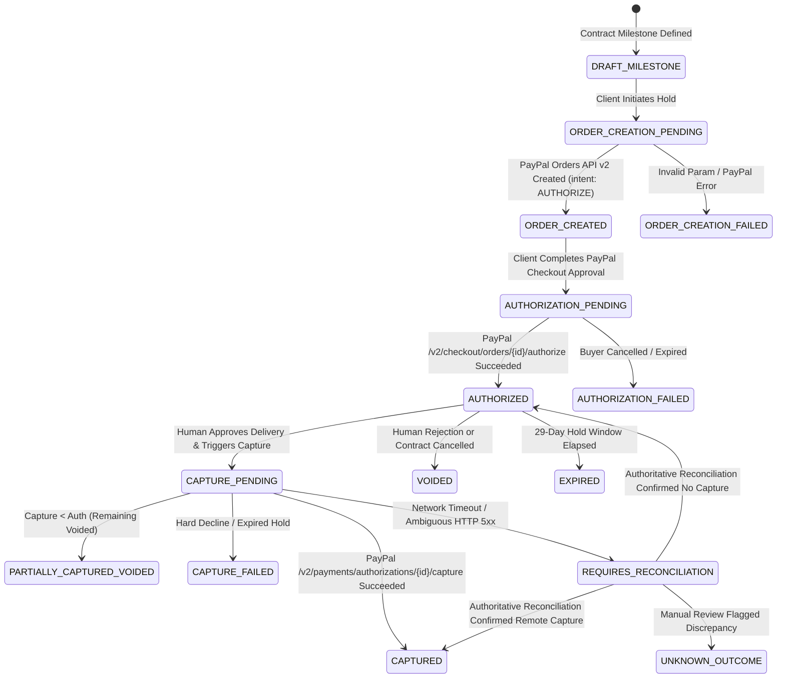

# PAYPAL_LIFECYCLE_ARCHITECTURE.md — TrustChain PayPal Lifecycle Management Architecture

## 1. Executive Summary & Product Objective

TrustChain provides an evidence-to-settlement orchestration platform for software development contracts. A central value proposition of TrustChain is bridging technical milestone delivery verification with deterministic financial settlement via PayPal.

This document specifies the end-to-end architecture for **TrustChain PayPal Lifecycle Management**, covering:
1. The **PayPal Orders API v2** lifecycle using `intent: "AUTHORIZE"` holds and conditional capture.
2. The mandatory **Non-Escrow Disclosure** and regulatory boundaries.
3. The **AI Read-Only Boundary** (AI multi-agent evaluations are strictly advisory and cannot trigger or calculate financial operations).
4. The **Deterministic Settlement Policy Engine** governing permissible milestone payout calculations.
5. The **Explicit Human Approval Gate** (`APPROVE`) required before any financial capture.
6. The **Authoritative Payment Reconciliation Engine** that reconciles local state against PayPal remote records.
7. **Webhook Signature Verification and Out-of-Order Idempotency**.
8. Evaluation of **APIMatic API Context** and **PayPal Developer Sandbox MCP** integration.

---

## 2. Mandatory Legal & Regulatory Boundary: Non-Escrow Disclosure

> **MANDATORY DISCLOSURE:**
> TrustChain is an orchestration and verification platform; **TrustChain is NOT a bank, money transmitter, or custodial escrow agent**.
> 
> All payment authorization holds, captures, voids, and refunds are executed directly between the client, developer, and PayPal via **PayPal Orders API v2** (`intent: "AUTHORIZE"`).
> - Funds authorized by the client remain in the client's PayPal account under a temporary hold (a 3-day honor period and up to a 29-day validity window) subject to PayPal's User Agreement.
> - TrustChain never holds, pools, or takes custody of client or developer funds.
> - Authorizations that are not captured within 29 days automatically expire under standard PayPal rules.

Every payment transaction record, API response, UI screen, and audit log payload incorporates or links to this non-escrow notice (`PAYPAL_NON_ESCROW_DISCLOSURE`).

---

## 3. End-to-End Payment Lifecycle State Machine

The payment lifecycle transitions through explicit states, prohibiting skipped steps or invalid transitions:

### 3.1 State Definitions

| State | Category | Description |
| :--- | :--- | :--- |
| `ORDER_CREATION_PENDING` | Transitional | Client initiated order creation; awaiting PayPal Orders API v2 response. |
| `ORDER_CREATED` | Resting | PayPal order created with `intent: "AUTHORIZE"`; awaiting client authorization in checkout. |
| `AUTHORIZATION_PENDING` | Transitional | Authorization capture requested; awaiting PayPal confirmation. |
| `AUTHORIZED` | Resting | Funds successfully authorized by PayPal. 29-day hold active. Milestone locked to hold. |
| `AUTHORIZATION_FAILED` | Terminal/Retryable | Buyer declined in PayPal checkout or authorization request failed. |
| `CAPTURE_PENDING` | Transitional | Human approval verified; capture request dispatched to PayPal. |
| `CAPTURED` | Terminal | 100% of authorized amount captured and credited to developer. Milestone status `SETTLED`. |
| `PARTIALLY_CAPTURED_VOIDED` | Terminal | Permitted amount (< 100%) captured; uncaptured remainder voided back to client. |
| `CAPTURE_FAILED` | Terminal | PayPal rejected capture (e.g. card closed, fraud hold, expired authorization). |
| `REQUIRES_RECONCILIATION` | Exception | Transient network error/timeout occurred during capture; local status unknown until reconciled. |
| `UNKNOWN_OUTCOME` | Exception | Reconciliation detected severe discrepancy requiring manual compliance/fiduciary intervention. |
| `VOIDED` | Terminal | Authorization explicitly voided before capture (e.g., milestone rejected or cancelled). |
| `EXPIRED` | Terminal | 29-day authorization hold expired without capture. |

---

## 4. Separation of Concerns & Security Boundaries

### 4.1 AI Advisory Boundary vs. Deterministic Settlement
1. **AI Agents (Evidence Agent, Risk Agent, Arbitrator Agent)**:
   - Run exclusively in a read-only analysis sandbox.
   - Outputs are strictly JSON recommendations (`ArbitratorRecommendation`: `APPROVED`, `PARTIAL_PAYMENT_PROPOSED`, `REVISION_REQUESTED`, `REJECTED`).
   - **Zero financial authority**: AI agent prompts, tools, or responses cannot call PayPal APIs, alter contract budgets, or bypass approvals.
2. **Deterministic Settlement Policy Engine**:
   - Pure, deterministic TypeScript code (`SettlementPolicyService`).
   - Applies contract formulas:
     $$\text{PermittedAmount} = \text{AgreedAmount} \times \min(1.0, \text{CriteriaPassingRatio}) \times (1.0 - \text{RiskPenalty})$$
   - Applies hard gates: if Prompt Injection or Critical Vulnerability detected, $\text{PermittedAmount} \equiv \$0.00$.
   - Arithmetic is computed strictly in integer cents (avoiding IEEE-754 floating point imprecision).
3. **Explicit Human Review Gate**:
   - `captureAuthorization` requires an existing `human_approvals` row with `decision === 'APPROVE'` signed by an authorized contract participant (`CLIENT` or `REVIEWER`).
   - Developer cannot approve their own milestone or trigger settlement.

---

## 5. Authoritative Payment Reconciliation Engine

### 5.1 The Problem
In distributed payment orchestration, distributed transactions across TrustChain and PayPal can encounter:
- HTTP 504 Gateway Timeout or TCP socket resets during capture.
- Delayed or dropped webhook notifications.
- Out-of-band actions taken directly in the PayPal Merchant/Buyer Dashboard (e.g., buyer cancelled authorization, PayPal risk team placed a hold).

### 5.2 Reconciliation Architecture
The Reconciliation Engine (`PayPalService.reconcilePayment`) acts as the single source of truth reconciler:
1. **Reads Authoritative Remote Record**:
   - For an order: Queries `GET /v2/checkout/orders/{id}`.
   - For an authorization: Queries `GET /v2/payments/authorizations/{authorization_id}`.
2. **Compares Local vs. Remote Attributes**:
   - Order IDs, Authorization IDs, Capture IDs.
   - Amounts: `authorizedAmountCents` and `capturedAmountCents`.
   - Lifecycle Status: verifies whether remote is `COMPLETED`, `VOIDED`, `DENIED`, or `EXPIRED`.
3. **Determines Outcomes**:
   - `IN_SYNC`: Local record and remote PayPal state match completely.
   - `RECONCILED_LOCAL_UPDATED`: Remote succeeded/changed out-of-band; local record updated to match PayPal reality.
   - `MANUAL_INTERVENTION_REQUIRED`: Severe discrepancy detected (e.g. captured amount differs from approved amount).
   - `REMOTE_RECORD_NOT_FOUND`: Order/Authorization ID does not exist in PayPal.
4. **Audit Durability**:
   - Appends an immutable audit event (`PAYPAL_PAYMENT_RECONCILED`) with full before/after diffs and operator attribution.

---

## 6. Webhook Verification & Out-of-Order Idempotency

### 6.1 Cryptographic Signature Verification
TrustChain validates every inbound PayPal webhook using PayPal's verification endpoint:
`POST /v1/notifications/verify-webhook-signature` with:
- `transmission_id`: From header `paypal-transmission-id`.
- `transmission_time`: From header `paypal-transmission-time`.
- `cert_url`: From header `paypal-cert-url` (must be HTTPS from `*.paypal.com`).
- `auth_algo`: From header `paypal-auth-algo`.
- `transmission_sig`: From header `paypal-transmission-sig`.
- `webhook_id`: Configured webhook ID from environment.
- `webhook_event`: Raw JSON payload.

### 6.2 Idempotent Deduplication
Webhook events are recorded in `paypal_webhook_events`. If a delivery ID is received that is already marked `PROCESSED`, the handler immediately returns `200 OK` without re-executing state transitions.

### 6.3 Monotonic State Guards
Webhooks arriving out-of-order (e.g. `PAYMENT.AUTHORIZATION.VOIDED` arriving after `PAYMENT.CAPTURE.COMPLETED`) are checked against current local state. A terminal `CAPTURED` state cannot be overwritten by an obsolete authorization event.

---

## 7. Sponsor Technology Integrations

### 7.1 APIMatic API Context Evaluation
- **Status in Antigravity Environment**: The APIMatic API Context Plugin was evaluated via `search_marketplace` and is currently unavailable in the Antigravity marketplace registry (`{"results":[]}`).
- **Integration Approach**: TrustChain utilizes APIMatic-compatible OpenAPI 3.0.3 contracts (`openapi.yaml` and `APIMATIC-META.json`). All route schemas, parameter validations, and idempotency headers adhere strictly to APIMatic standards and official `@paypal/paypal-server-sdk` definitions.

### 7.2 PayPal Developer Sandbox MCP
- **MCP Server**: `paypal-mcp-server` is configured and accessible in Antigravity.
- **Tested Tools**: `create_order`, `get_order`, `pay_order`.
- **Live Validation**: Validated live against PayPal Developer Sandbox with live sandbox order `74D011968N1850338` ($25.00 USD).

---

## 8. Financial Invariants & Safety Summary

1. **Non-Escrow Compliance**: Never claim custodial escrow; declare 29-day authorization hold model.
2. **Server-Side Integer Cents**: Never accept client-supplied payment amounts. All amounts derived from milestone and settlement policy.
3. **No AI Direct Financial Power**: Multi-agent advice requires human review and explicit client/reviewer trigger.
4. **Idempotency Guard**: All mutating PayPal operations enforce unique `PayPal-Request-Id` and database uniqueness.
5. **ACID Concurrency**: SQLite `withTransaction` ensures simultaneous double-captures are prevented by database-level locks.
