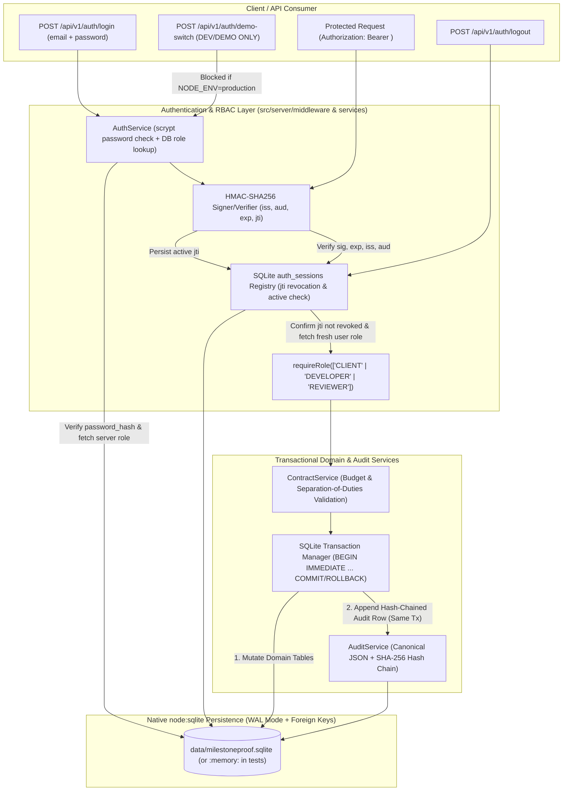

# Phase 1 Security, Authentication, SQLite Persistence & Audit-Chain Review — MilestoneProof AI

## 1. Executive Summary & Architecture Validation (Section D)

Before writing any Phase 1 application code, we re-inspected the actual repository and runtime environment to validate every architectural assumption:

### 1.1 Verified Repository & Runtime State
- **OS & Node.js Runtime Verified:** Windows with **Node.js `v24.14.0`**.
- **Native Modules Verified via Execution:**
  - `node:sqlite` (`DatabaseSync`) executed and verified working in `Node.js v24.14.0` (note: Node v24 emits an `ExperimentalWarning` on first import, which we document transparently).
  - `node:crypto` (asynchronous `scrypt`, `randomBytes`, `randomUUID`, `createHmac`, `createHash`, `timingSafeEqual`) verified working.
- **TypeScript Definitions Check (`package.json`):**
  - `package.json` has `"typescript": "^7.0.2"` and `"@types/node": "^22.14.0"`.
  - Direct inspection of `node_modules/@types/node` confirmed that `@types/node@22.14.0` does **not** include `sqlite.d.ts`. Therefore, to preserve `npm run lint` (`tsc --noEmit`) with zero errors and **zero package installations**, Phase 1 will include a dedicated ambient declaration file `src/types/node-sqlite.d.ts` typing `node:sqlite`.
- **Preservation of Existing Working Architecture:**
  - Existing files (`package.json`, `vite.config.ts`, `tsconfig.json`, `index.html`, `src/main.tsx`, `src/App.tsx`, `src/index.css`) contain a frontend-only Vite + React 19 + Tailwind CSS v4 skeleton (`src/App.tsx` renders `<div></div>`).
  - `express` (`^4.21.2`) and `dotenv` (`^17.2.3`) are already pre-installed in `package.json`, and `npm run clean` (`rm -rf dist server.js`) confirms the project was originally scaffolded for an Express + Vite modular monolith.
  - Therefore, adding `src/server/*` with Express + `node:sqlite` **does not replace any existing backend architecture**—it fulfills the missing server layer using the exact dependencies already present in `package.json`.

---

## 2. Revised Phase 1 Architecture



---

## 3. Section A — Authentication & RBAC Design

### 3.1 Core Security Principle: HMAC Signing != Identity Verification
An HMAC-SHA256 signature only proves that a token was issued by our server and has not been modified in transit. **It does not authenticate who the user is at login time.**
Therefore:
1. **Credential Verification Before Token Issuance (`POST /api/v1/auth/login`):**
   - Request body accepts **only** `{ email: string, password: string }`.
   - Any client-supplied `role` field in the login request is strictly rejected (`400 ROLE_SELECTION_FORBIDDEN`).
   - `AuthService.login()` looks up the user by `email` in the `users` table, verifies `is_active === 1`, and asynchronously verifies the password against `users.password_hash` (stored as `salt_hex:scrypt_hash_hex`) using **non-blocking asynchronous `crypto.scrypt()`** and `crypto.timingSafeEqual` so CPU-intensive key derivation never blocks the Node.js event loop.
   - The user's `role` (`CLIENT`, `DEVELOPER`, or `REVIEWER`) is loaded **exclusively from `users.role` in SQLite**.
2. **Explicit Isolation of Hackathon Demo Persona Switcher (`POST /api/v1/auth/demo-switch`):**
   - To allow hackathon judges to switch between the seeded `Client`, `Developer`, and `Reviewer` personas in the UI without typing passwords repeatedly, we provide `POST /api/v1/auth/demo-switch` accepting `{ userId: string }`.
   - **Strict Environment Gate:** This endpoint checks:
     ```ts
     const isDemoModeAllowed =
       process.env.NODE_ENV !== 'production' &&
       process.env.ENABLE_DEMO_IMPERSONATION === 'true';
     ```
   - **Disabled in Production:** If `NODE_ENV === 'production'` or `ENABLE_DEMO_IMPERSONATION !== 'true'`, the endpoint immediately returns `403 DEMO_MODE_DISABLED` without issuing a token.
   - **Server-Side Role Resolution:** Even when enabled in demo mode, the client **cannot** request an arbitrary role (e.g., `{ userId: "dev_01", role: "REVIEWER" }`). The server looks up `userId` in `users`, verifies `users.is_demo_account === 1`, assigns the role strictly from `users.role` in the database, and writes an immutable `AUTH_DEMO_SWITCH` event to `audit_logs`.

### 3.2 Token Structure, Claims & Validation Rules
Tokens follow a compact 3-part signed structure (`<headerB64Url>.<payloadB64Url>.<hmacSha256B64Url>`):
- **Header:** `{ "alg": "HS256", "typ": "MPAI-JWT" }`
- **Payload (`SessionTokenClaims`):**
  ```json
  {
    "jti": "c9a4f8b2-1e3d-4a5b-8c9d-0e1f2a3b4c5d",
    "sub": "client_01",
    "role": "CLIENT",
    "iss": "milestoneproof-ai-server",
    "aud": "milestoneproof-ai-api",
    "iat": 1793970000,
    "exp": 1793973600
  }
  ```
- **Verification Steps on Every Protected Request (`authMiddleware.ts`):**
  1. Extract `Authorization: Bearer <token>`. (Raw `X-Actor-Id` headers are **never** accepted for authentication; sending `X-Actor-Id` without a valid Bearer token returns `401 AUTH_TOKEN_REQUIRED`).
  2. Parse 3 segments and verify header `alg === "HS256"` and `typ === "MPAI-JWT"`.
  3. Recompute HMAC-SHA256 over `<headerB64Url>.<payloadB64Url>` using the server's secret key and compare with `crypto.timingSafeEqual`.
  4. Validate `iss === "milestoneproof-ai-server"` and `aud === "milestoneproof-ai-api"`.
  5. Validate `nowSec >= payload.iat` and `nowSec < payload.exp` (default TTL: 3600 seconds / 1 hour).
  6. Query `auth_sessions` in SQLite by `jti` joined with `users`:
     - Confirm session row exists and `revoked_at IS NULL`.
     - Confirm `users.is_active === 1`.
     - Override `req.actor.role` with the live `users.role` from the database so that even if a user's role was changed after token issuance, the database remains the single source of truth.

### 3.3 Secret Management, Local Restart Behavior & Revocation / Logout Strategy
- **Secret Management & Local Ephemeral Restart Behavior:**
  - Configured via `AUTH_TOKEN_SECRET` in `.env` (minimum 32 characters / 256 bits).
  - **Production Requirement:** If `NODE_ENV === 'production'` and `AUTH_TOKEN_SECRET` is missing or shorter than 32 characters, the server refuses to start (`FATAL_INSECURE_AUTH_SECRET`). Production deployments must configure a stable, securely managed `AUTH_TOKEN_SECRET` so active user sessions remain valid across rolling restarts.
  - **Local Ephemeral Secret Behavior:** In local development/test (`NODE_ENV !== 'production'`), if `AUTH_TOKEN_SECRET` is unset, `AuthService` generates an ephemeral per-process 32-byte random secret via `crypto.randomBytes(32).toString('hex')` and logs a development warning—**zero hardcoded fallback secrets exist in the source code**. Because this ephemeral secret changes whenever the server restarts (unless `AUTH_TOKEN_SECRET` is set in `.env`), any token issued prior to a server restart will fail HMAC signature verification (`401 INVALID_TOKEN_SIGNATURE`) after restart and require re-authentication.
- **Revocation & Logout (`auth_sessions` Table):**
  - `POST /api/v1/auth/logout`: Marks the current token's `jti` as revoked (`UPDATE auth_sessions SET revoked_at = ?, revoke_reason = 'USER_LOGOUT' WHERE jti = ?`) and writes an `AUTH_LOGOUT` audit entry in the same transaction.
  - `POST /api/v1/auth/revoke-all`: Marks all active tokens for `req.actor.id` as revoked.

---

## 4. Section B — SQLite Persistence, Schema & Transaction Boundaries

### 4.1 Connection Configuration, PRAGMAs & Durability Evaluation (`FULL` vs. `NORMAL`)
When `Database.ts` opens a `DatabaseSync` connection (either `data/milestoneproof.sqlite` or `:memory:` for isolated unit tests), it immediately executes:
```sql
PRAGMA journal_mode = WAL;
PRAGMA synchronous = FULL;
PRAGMA foreign_keys = ON;
PRAGMA busy_timeout = 5000;
```
- **Durability Evaluation (`PRAGMA synchronous = FULL` vs. `NORMAL`):**
  - In WAL mode with `synchronous = NORMAL`, SQLite omits `fsync()` after individual WAL frame writes and only syncs at checkpoints. While faster for non-critical telemetry, an OS crash or sudden power loss before a checkpoint can lose recently committed transactions—meaning a committed financial approval or audit log entry could be lost on power failure.
  - With **`PRAGMA synchronous = FULL`**, SQLite issues an OS `fsync()` to flush the WAL to disk on every `COMMIT`. Because MilestoneProof AI manages financial approvals, contractual state transitions, and tamper-evident audit chains where durability (`D` in ACID) is mandatory, **`PRAGMA synchronous = FULL` is used**.

### 4.2 Database Schema, Constraints & Indexes (Migration `001_initial_phase1_schema`)

```sql
CREATE TABLE IF NOT EXISTS schema_migrations (
  version INTEGER PRIMARY KEY,
  name TEXT NOT NULL,
  applied_at TEXT NOT NULL
);

CREATE TABLE IF NOT EXISTS users (
  id TEXT PRIMARY KEY,
  name TEXT NOT NULL,
  email TEXT UNIQUE NOT NULL,
  password_hash TEXT NOT NULL,
  role TEXT NOT NULL CHECK (role IN ('CLIENT', 'DEVELOPER', 'REVIEWER')),
  is_active INTEGER NOT NULL DEFAULT 1 CHECK (is_active IN (0, 1)),
  is_demo_account INTEGER NOT NULL DEFAULT 0 CHECK (is_demo_account IN (0, 1)),
  created_at TEXT NOT NULL
);

CREATE TABLE IF NOT EXISTS auth_sessions (
  jti TEXT PRIMARY KEY,
  user_id TEXT NOT NULL REFERENCES users(id) ON DELETE RESTRICT,
  role TEXT NOT NULL CHECK (role IN ('CLIENT', 'DEVELOPER', 'REVIEWER')),
  issued_at INTEGER NOT NULL,
  expires_at INTEGER NOT NULL,
  revoked_at TEXT NULL,
  revoke_reason TEXT NULL,
  CHECK (expires_at > issued_at)
);
CREATE INDEX IF NOT EXISTS idx_auth_sessions_user_id ON auth_sessions(user_id);

CREATE TABLE IF NOT EXISTS contracts (
  id TEXT PRIMARY KEY,
  title TEXT NOT NULL CHECK (length(trim(title)) > 0),
  description TEXT NOT NULL,
  total_budget_cents INTEGER NOT NULL CHECK (total_budget_cents > 0),
  currency TEXT NOT NULL CHECK (currency = 'USD'),
  client_id TEXT NOT NULL REFERENCES users(id) ON DELETE RESTRICT,
  developer_id TEXT NOT NULL REFERENCES users(id) ON DELETE RESTRICT,
  reviewer_id TEXT NOT NULL REFERENCES users(id) ON DELETE RESTRICT,
  policy_rules_json TEXT NOT NULL,
  status TEXT NOT NULL CHECK (status IN ('DRAFT', 'ACTIVE', 'COMPLETED', 'CANCELLED')),
  version INTEGER NOT NULL DEFAULT 1 CHECK (version >= 1),
  created_at TEXT NOT NULL,
  updated_at TEXT NOT NULL,
  CHECK (developer_id != reviewer_id),
  CHECK (client_id != developer_id)
);
CREATE INDEX IF NOT EXISTS idx_contracts_client_id ON contracts(client_id);
CREATE INDEX IF NOT EXISTS idx_contracts_developer_id ON contracts(developer_id);
CREATE INDEX IF NOT EXISTS idx_contracts_reviewer_id ON contracts(reviewer_id);

CREATE TABLE IF NOT EXISTS milestones (
  id TEXT PRIMARY KEY,
  contract_id TEXT NOT NULL REFERENCES contracts(id) ON DELETE RESTRICT,
  sequence_order INTEGER NOT NULL CHECK (sequence_order >= 1),
  title TEXT NOT NULL CHECK (length(trim(title)) > 0),
  description TEXT NOT NULL,
  agreed_amount_cents INTEGER NOT NULL CHECK (agreed_amount_cents > 0),
  deadline_iso TEXT NOT NULL,
  dependency_milestone_ids_json TEXT NOT NULL DEFAULT '[]',
  acceptance_criteria_json TEXT NOT NULL,
  status TEXT NOT NULL CHECK (status IN (
    'DRAFT', 'ACTIVE', 'SUBMITTED', 'EVALUATING', 'PENDING_REVIEW',
    'APPROVED', 'REVISION_REQUESTED', 'REJECTED', 'SETTLED', 'PAY_FAILED'
  )),
  payment_status TEXT NOT NULL CHECK (payment_status IN (
    'NOT_READY', 'ORDER_CREATED', 'AUTHORIZED', 'CAPTURE_PENDING',
    'CAPTURED', 'VOIDED', 'FAILED', 'EXPIRED'
  )),
  created_at TEXT NOT NULL,
  updated_at TEXT NOT NULL,
  UNIQUE (contract_id, sequence_order)
);
CREATE INDEX IF NOT EXISTS idx_milestones_contract_id ON milestones(contract_id);
CREATE INDEX IF NOT EXISTS idx_milestones_status ON milestones(status);

CREATE TABLE IF NOT EXISTS audit_logs (
  seq INTEGER PRIMARY KEY AUTOINCREMENT,
  id TEXT UNIQUE NOT NULL,
  timestamp TEXT NOT NULL,
  actor_id TEXT NOT NULL REFERENCES users(id) ON DELETE RESTRICT,
  actor_role TEXT NOT NULL CHECK (actor_role IN ('CLIENT', 'DEVELOPER', 'REVIEWER', 'SYSTEM')),
  action TEXT NOT NULL,
  entity_type TEXT NOT NULL,
  entity_id TEXT NOT NULL,
  contract_id TEXT NULL REFERENCES contracts(id) ON DELETE RESTRICT,
  milestone_id TEXT NULL REFERENCES milestones(id) ON DELETE RESTRICT,
  previous_state TEXT NULL,
  new_state TEXT NULL,
  payload_json TEXT NOT NULL,
  previous_hash TEXT NOT NULL CHECK (length(previous_hash) = 64),
  entry_hash TEXT UNIQUE NOT NULL CHECK (length(entry_hash) = 64)
);
CREATE INDEX IF NOT EXISTS idx_audit_logs_contract_id ON audit_logs(contract_id);
CREATE INDEX IF NOT EXISTS idx_audit_logs_milestone_id ON audit_logs(milestone_id);
CREATE INDEX IF NOT EXISTS idx_audit_logs_entity_id ON audit_logs(entity_id);
```

*(Note: Tables for `evidence_submissions`, `ai_evaluations`, `human_approvals`, and `payment_transactions` are also created in the migration with foreign keys so the schema is 100% ready for Phases 5–7).*

### 4.3 Explicit Transaction Boundaries (`withTransaction`)
Every state-mutating operation executes inside `db.withTransaction(() => { ... })`, which issues `BEGIN IMMEDIATE TRANSACTION`:
1. **`ContractService.createContract()`:**
   - Begins immediate transaction.
   - Inserts row into `contracts`.
   - Inserts all milestone rows into `milestones`.
   - Appends `CONTRACT_CREATED` hash-chained record into `audit_logs` (and one `MILESTONE_CREATED` record per milestone).
   - Commits transaction. If any constraint fails or an error is thrown (even during audit insertion), the entire transaction rolls back so zero partial contracts, milestones, or audit logs persist.
2. **`ContractService.activateContract()`:**
   - Begins immediate transaction.
   - Verifies contract is in `DRAFT` state and increments `version`.
   - Updates `contracts.status = 'ACTIVE'` and `milestones.status = 'ACTIVE'`.
   - Appends `CONTRACT_ACTIVATED` hash-chained record into `audit_logs`.
   - Commits transaction.
3. **`AuthService.login()` / `demoSwitch()` / `logout()`:**
   - Inserts/updates `auth_sessions` and appends `AUTH_LOGIN` / `AUTH_DEMO_SWITCH` / `AUTH_LOGOUT` into `audit_logs` within a single `BEGIN IMMEDIATE` transaction.

---

## 5. Section C — Hash-Chained Audit Log Design

### 5.1 Genesis Hash & Canonical Payload Serialization
- **Known Genesis Constant:**
  ```ts
  export const AUDIT_GENESIS_HASH = crypto
    .createHash('sha256')
    .update('MILESTONEPROOF_AI_AUDIT_GENESIS_V1')
    .digest('hex');
  // Value: "9f64a747e1b97f131fabb6b447296c9b6f0201e79fb3c5356e6c77e89b6a806a" (deterministic 64-hex)
  ```
- **Canonical JSON Serialization (`canonicalizeJson`):**
  - Recursively sorts all object keys lexicographically (`Object.keys(obj).sort()`) and strips `undefined` properties before calling `JSON.stringify`, guaranteeing that `{ b: 1, a: 2 }` and `{ a: 2, b: 1 }` always produce the exact same string `"{\"a\":2,\"b\":1}"`.
- **Preimage & `entry_hash` Formula:**
  For an entry with sequence number `seq`:
  ```ts
  const preimage = [
    String(seq),
    timestamp,
    actorId,
    actorRole,
    action,
    entityType,
    entityId,
    contractId ?? '',
    milestoneId ?? '',
    previousState ?? '',
    newState ?? '',
    canonicalPayloadJson,
    previousHash,
  ].join('|');

  const entryHash = crypto.createHash('sha256').update(preimage, 'utf8').digest('hex');
  ```

### 5.2 Chain Verification Algorithm (`AuditService.verifyChain()`)
`verifyChain()` fetches all rows from `audit_logs` ordered by `seq ASC` and checks:
1. **Empty Chain:** Valid (`verifiedCount: 0`, `headHash: AUDIT_GENESIS_HASH`).
2. **Genesis Link (`i === 0`):**
   - Must have `row.seq === 1` (if `row.seq !== 1`, returns `{ valid: false, reason: 'MISSING_GENESIS_ENTRY', failedSeq: row.seq }`).
   - Must have `row.previous_hash === AUDIT_GENESIS_HASH` (if not, returns `{ valid: false, reason: 'INVALID_GENESIS_PREVIOUS_HASH', failedSeq: 1 }`).
3. **Contiguous Sequence Check (`i > 0`):**
   - Must have `row.seq === prevRow.seq + 1`. If `row.seq !== prevRow.seq + 1`, a row was **deleted** or **skipped** -> returns `{ valid: false, reason: 'SEQUENCE_GAP_DETECTED', failedSeq: row.seq }`.
4. **Hash Link Check (`i > 0`):**
   - Must have `row.previous_hash === prevRow.entry_hash`. If not, rows were **reordered** or linked improperly -> returns `{ valid: false, reason: 'BROKEN_PREVIOUS_HASH_LINK', failedSeq: row.seq }`.
5. **Content & Canonical Payload Integrity Check:**
   - Re-canonicalizes `JSON.parse(row.payload_json)` and recomputes `expectedEntryHash`.
   - If `expectedEntryHash !== row.entry_hash`, the entry's columns or JSON payload were **altered** -> returns `{ valid: false, reason: 'ENTRY_HASH_MISMATCH', failedSeq: row.seq }`.

### 5.3 Tamper-Evident vs. Tamper-Proof Disclosure & Future External Anchoring
- **Explicit Architectural Limitation:** Because the `audit_logs` table lives inside the same SQLite database file as the application data, this hash chain is **tamper-evident** (it immediately detects accidental corruption, partial writes, or single-row SQL edits/deletions), **not tamper-proof** against a privileged attacker with direct filesystem write access to `milestoneproof.sqlite` (who could rewrite row #1 and recompute every downstream hash in `audit_logs`).
- **Future Production Anchoring Strategy:** In a production financial environment, every $N$ audit entries (or every 5 minutes), the system should compute a checkpoint `{ seq, timestamp, entryHash }`, sign it using an isolated Cloud KMS / HSM asymmetric private key whose private key never resides on the application server, and publish the signed checkpoint to an external append-only witness store (e.g., an S3 Object Lock WORM bucket or transparency log).

---

## 6. Revised Phase 1 API Endpoints

| Method | Endpoint | Auth / RBAC | Purpose |
| :--- | :--- | :--- | :--- |
| `GET` | `/api/v1/health` | Public | Server status, runtime version, demo mode flag, and capability flags. |
| `POST` | `/api/v1/auth/login` | Public | Authenticates `{ email, password }`, looks up server-side `users.role`, records `jti` in `auth_sessions`, and returns signed Bearer token. |
| `POST` | `/api/v1/auth/demo-switch` | Public (**Dev/Demo Only**) | Issues signed token for a seeded demo `userId` (`is_demo_account=1`). Returns `403 DEMO_MODE_DISABLED` if `NODE_ENV=production` or `ENABLE_DEMO_IMPERSONATION!=true`. |
| `GET` | `/api/v1/auth/me` | Authenticated | Validates Bearer token + active session `jti` and returns current actor profile & role. |
| `POST` | `/api/v1/auth/logout` | Authenticated | Revokes the active token's `jti` in `auth_sessions` (`revoked_at`) and logs `AUTH_LOGOUT`. |
| `GET` | `/api/v1/users` | Authenticated | Lists registered personas (excluding `password_hash`) for contract participant selection. |
| `GET` | `/api/v1/contracts` | Authenticated | Lists all contracts with their milestones. |
| `GET` | `/api/v1/contracts/:id` | Authenticated | Retrieves a specific contract and its milestones. |
| `POST` | `/api/v1/contracts` | `CLIENT` only | Transactional creation of contract + milestones + hash-chained audit logs. |
| `POST` | `/api/v1/contracts/:id/activate` | `CLIENT` only | Transactional transition of contract & milestones from `DRAFT` to `ACTIVE` + audit log. |
| `GET` | `/api/v1/audit` | Authenticated | Lists hash-chained audit entries (filterable by `contractId`, `milestoneId`, `entityId`). |
| `GET` | `/api/v1/audit/verify` | Authenticated | Runs `AuditService.verifyChain()` across all audit entries and returns chain integrity report. |

---

## 7. Comprehensive Phase 1 Automated Test Plan (`src/server/__tests__/phase1.test.ts`)

1. **Authentication, Token Security & RBAC Tests:**
   - **Valid Login:** `POST /api/v1/auth/login` with valid email & password returns signed token with database-resolved role (`CLIENT`, `DEVELOPER`, `REVIEWER`).
   - **Invalid Password / Unknown User:** Rejects with `401 INVALID_CREDENTIALS`.
   - **Spoofing Prevention:** Calling `POST /api/v1/contracts` with only a raw `X-Actor-Id: client_01` header and no Bearer token is rejected with `401 AUTH_TOKEN_REQUIRED`.
   - **Role Escalation Prevention (Login Payload):** Sending `{ email: "dev@...", password: "...", role: "REVIEWER" }` ignores/rejects the client-supplied `role` and issues only a `DEVELOPER` token.
   - **Role Escalation Prevention (Tampered Token Payload):** Modifying the base64 payload of a `DEVELOPER` token to `"role": "REVIEWER"` is rejected with `401 INVALID_TOKEN_SIGNATURE`.
   - **Expired Token Rejection:** A token with `exp` in the past is rejected with `401 TOKEN_EXPIRED`.
   - **Invalid `iss` / `aud` Claims Rejection:** Tokens signed with wrong `iss` or `aud` are rejected with `401 INVALID_TOKEN_CLAIMS`.
   - **Logout & Token Revocation:** After calling `POST /api/v1/auth/logout`, reusing the same token is rejected with `401 TOKEN_REVOKED`.
   - **Production Demo Impersonation Lockout:** When `ENABLE_DEMO_IMPERSONATION` is `'false'` or `NODE_ENV === 'production'`, `POST /api/v1/auth/demo-switch` returns `403 DEMO_MODE_DISABLED`.
   - **RBAC Enforcement:** A valid `DEVELOPER` or `REVIEWER` token calling `POST /api/v1/contracts` or `POST /api/v1/contracts/:id/activate` is rejected with `403 FORBIDDEN_ROLE`.

2. **SQLite Persistence, Constraints & Transaction Tests:**
   - **Atomic Rollback on Failure:** Simulate an error during audit log insertion or milestone insertion inside `createContract()` and verify that `0` rows were committed to `contracts`, `milestones`, and `audit_logs`.
   - **Concurrent / Sequential Write Serialization:** Execute multiple concurrent contract/audit write operations against SQLite and verify all succeed in serialized order with contiguous `seq` numbers (`1..N`) and zero corrupt records.
   - **Persistence Across Restart:** Create a contract in a file-backed test SQLite database, close the `DatabaseSync` connection completely, instantiate a fresh `DatabaseSync` connection on the same file, and verify the contract, milestones, and audit chain persist intact.
   - **Database-Level Constraint Enforcement:** Verify foreign key enforcement (`PRAGMA foreign_keys = ON`) and `CHECK (developer_id != reviewer_id)` constraint.

3. **Hash-Chained Audit Verification Tests:**
   - **Intact Chain Verification:** `GET /api/v1/audit/verify` returns `{ valid: true }` after seed initialization, logins, contract creation, and contract activation.
   - **Altered Entry Detection:** Directly mutate `payload_json` or `new_state` of an existing row in `audit_logs` via raw SQL in a test -> `verifyChain()` returns `{ valid: false, reason: 'ENTRY_HASH_MISMATCH' }`.
   - **Deleted / Missing Entry Detection:** Delete a middle row (`DELETE FROM audit_logs WHERE seq = 2`) -> `verifyChain()` returns `{ valid: false, reason: 'SEQUENCE_GAP_DETECTED' }`.
   - **Missing Genesis Entry Detection:** Delete row `seq = 1` -> `verifyChain()` returns `{ valid: false, reason: 'MISSING_GENESIS_ENTRY' }`.
   - **Reordered / Broken Link Detection:** Swap `previous_hash` between two entries -> `verifyChain()` returns `{ valid: false, reason: 'BROKEN_PREVIOUS_HASH_LINK' }`.

---

## 8. Deployment Assumptions, Limitations & Remaining Risks

1. **Node.js Runtime Version Constraint (`>= 22.5.0` / `v24.x`):**
   - `node:sqlite` requires Node.js `>= 22.5.0` (verified on local `v24.14.0`). Any container or Cloud Run deployment must use a `node:22` (22.5+) or `node:24` base image.
2. **SQLite Single-Writer & Persistent Volume Requirement:**
   - SQLite supports a single concurrent writer per database file. It requires a mounted persistent volume if deployed to a container host; on stateless ephemeral containers without persistent disk mounts, the database resets when the container recycles.
   - **No False Production Claim:** This SQLite setup is designed for a self-contained single-instance modular monolith demonstration and local/CI verification, not a multi-region horizontally scaled production cluster.
3. **Tamper-Evident Audit Scope:**
   - Without an external KMS/HSM witness anchor, the audit hash chain detects accidental corruption and unauthorized single-row edits, but cannot prevent a root filesystem attacker from rewriting the entire SQLite file.
