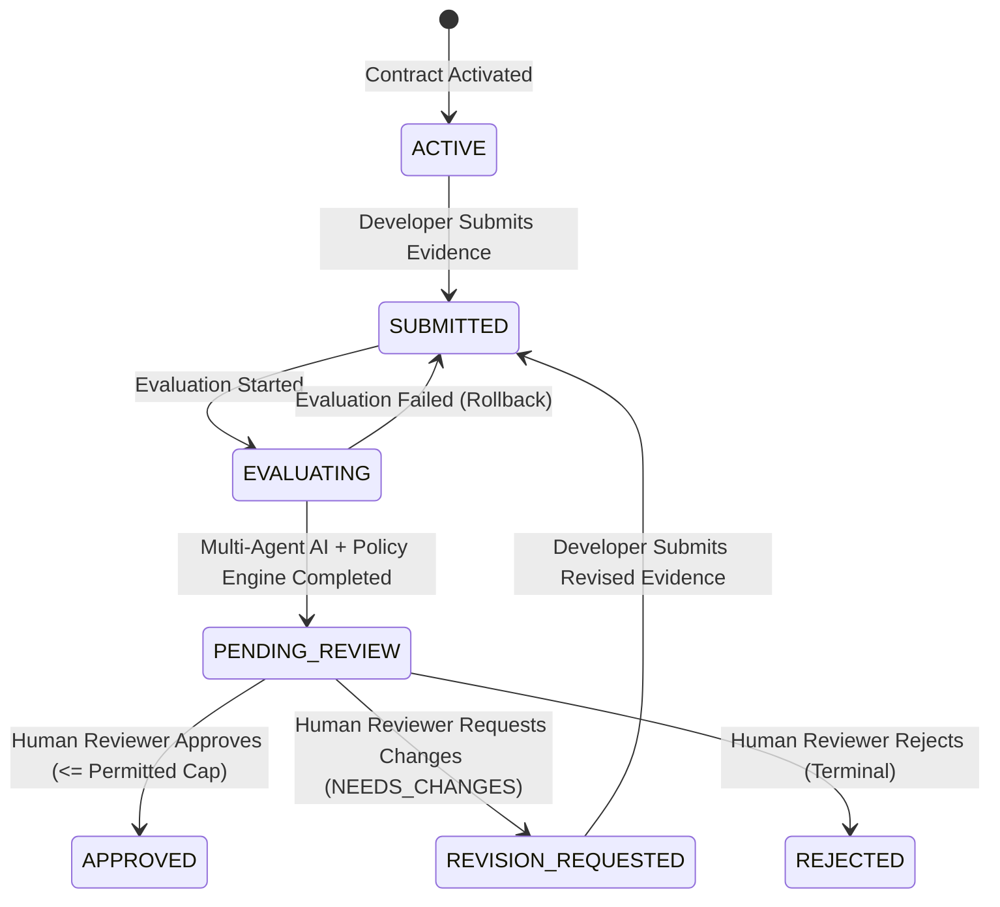

# PHASE 4 DESIGN — Deterministic Settlement Policy Engine, Human Review Workflow & Financial Decision Ledger

## 1. Architectural Overview

Phase 4 implements the dedicated deterministic `SettlementPolicyService`, the human fiduciary review workflow (`HumanReviewService` & `ReviewController`), the audit-traceable Financial Decision Intelligence Ledger (`GET /api/v1/ledger`), and the human-review workbench UI (`src/App.tsx`).

---

## 2. Dedicated `SettlementPolicyService` (`src/server/services/SettlementPolicyService.ts`)

1. **Pure Integer-Cent Mathematical Calculation (`calculatePolicy`):**
   - Validates `agreedAmountCents > 0`, `totalCriteriaCount >= 1`, and `0 <= verifiedCriteriaCount <= totalCriteriaCount` as integers.
   - Evaluates mandatory contractual gates (`gatesTripped` / `blockingReasons`):
     - `GATE_PROMPT_INJECTION_DETECTED`
     - `GATE_CI_BUILD_FAILED` (`requirePassingCi && !ciBuildPassed`)
     - `GATE_SECURITY_SCANNER_UNAVAILABLE` (`requireSecurityScan && scannerStatus !== 'AVAILABLE'`)
     - `GATE_CRITICAL_VULNS_EXCEEDED` (`criticalVulnCount > maxAllowedCriticalVulns`)
     - `GATE_HIGH_VULNS_EXCEEDED` (`highVulnCount > maxAllowedHighVulns`)
     - `GATE_PARTIAL_DELIVERY_DISALLOWED` (`!allowPartialPayout && (verified < total || missingEvidenceCount > 0)`)
     - `GATE_MANDATORY_EVIDENCE_MISSING` (`verifiedCriteriaCount === 0`)
   - Computes:
     - `grossEligibleCents = Math.floor((agreedAmountCents * verifiedCriteriaCount) / totalCriteriaCount)`
     - `lateDays = max(0, ceil((submittedMs - deadlineMs) / 86400000))`
     - `latePenaltyCents = min(grossEligibleCents, Math.floor((agreedAmountCents * lateDays * latePenaltyDailyBps) / 10000))`
     - `permittedAmountCents = gateBlocked ? 0 : max(0, min(agreedAmountCents, grossEligibleCents - latePenaltyCents))`
     - `deductionCents = agreedAmountCents - permittedAmountCents`
2. **Payout Cap Validation (`validateApprovedAmount`):**
   - Rejects non-integer amounts (`400 NON_INTEGER_AMOUNT_CENTS`), `<= 0` amounts (`400 INVALID_APPROVAL_AMOUNT`), amounts exceeding `milestone.agreedAmountCents` (`400 AMOUNT_EXCEEDS_MILESTONE_BUDGET`), blocked policy gates (`422 POLICY_GATE_BLOCKED`), and amounts exceeding `policyCalculation.permittedAmountCents` (`400 AMOUNT_EXCEEDS_PERMITTED_CAP`).
3. **Zero AI Influence:**
   - `SettlementPolicyService` never receives or inspects AI recommendation strings (`PASS`, `FAIL`, `NEEDS_HUMAN_REVIEW`, `RECOMMEND_APPROVAL`).

---

## 3. Human Review Workflow & State Machine (`src/server/services/HumanReviewService.ts`)

### Endpoints Mounted:
- `GET /api/v1/milestones/:id/review` — Returns contract, milestone, `stateMachineStatus`, `latestSubmission`, `latestEvaluation`, re-verified `policyCalculation`, `approvals`, and `allowedActions` (`canApprove`, `canReject`, `canRequestChanges`, `maxPermittedAmountCents`, `blockingReasons`).
- `POST /api/v1/milestones/:id/review` — Unified human review endpoint (`decision: 'APPROVE' | 'REJECT' | 'REQUEST_REVISIONS' | 'NEEDS_CHANGES'`).
- `POST /api/v1/milestones/:id/review/approve` — Dedicated approval endpoint.
- `POST /api/v1/milestones/:id/review/reject` — Dedicated rejection endpoint.
- `POST /api/v1/milestones/:id/review/request-changes` — Dedicated request-for-changes endpoint.

### Security & Fiduciary Guards:
1. **Separation of Duties:** If `actor.id === contract.developerId` or `actor.role === 'DEVELOPER'`, rejects with `403 SELF_APPROVAL_FORBIDDEN`.
2. **Contract Reviewer Authorization:** Only the designated `contract.reviewerId` or `contract.clientId` with role `REVIEWER` or `CLIENT` may review (`403 FORBIDDEN_NOT_AUTHORIZED_REVIEWER`).
3. **State Machine Preconditions:**
   - Blocks duplicate approval (`409 DUPLICATE_APPROVAL_FORBIDDEN`).
   - Blocks approval after rejection (`409 REVIEW_LOCKED_AFTER_REJECTION`).
   - Blocks review before a completed evaluation exists for the latest submission (`409 EVALUATION_REQUIRED_BEFORE_REVIEW`).
   - Requires a non-empty justification (`>= 5` characters) on all decisions (`400 REVIEW_REASON_REQUIRED`).
4. **Concurrency & Transactionality:**
   - Guarded by `activeReviewLocks` and SQLite `BEGIN IMMEDIATE` transaction (`db.withTransaction()`) so `human_approvals`, `milestones.status`, and `audit_logs` always commit or roll back atomically.

---

## 4. Audit-Traceable Financial Decision Ledger (`GET /api/v1/ledger`)

Returns flattened `FinancialLedgerRow[]` records containing:
- `contractId`, `contractTitle`, `milestoneId`, `milestoneTitle`, `sequenceOrder`
- `milestoneStatus` and `stateMachineStatus` (`APPROVED`, `REJECTED`, `NEEDS_CHANGES`, `PENDING_REVIEW`, etc.)
- `submissionId`, `attemptNumber`, `evaluationId`, `verifiedRatioPct`, `riskSeverity`, `aiRecommendation`
- `policyEngineVersion`, `gateBlocked`, `blockingReasons`, `agreedAmountCents`, `permittedAmountCents`
- `approvalId`, `reviewerId`, `reviewerDecision`, `approvedAmountCents`, `decidedAt`
- `paymentEligible` (`boolean`) and `paymentStatus`
- `auditEventCount`, `auditTrailIds`, and `latestAuditEntryHash` (64-char SHA-256 digest)
