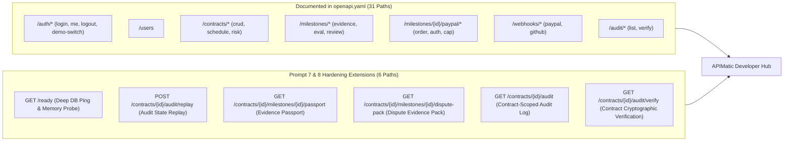

# TRUSTCHAIN — PROMPT 8/8
# API CONTRACT GAP ANALYSIS & APIMATIC DEVELOPER HUB READINESS

**Repository:** `Mohamed-529/TrustChain`  
**Specification:** OpenAPI 3.0.3 (`openapi.yaml`)  
**Evaluation Date:** November 9, 2026  
**Sponsor Integration Focus:** APIMatic Developer Hub, Code Generation & Contract Validation  

---

## 1. Executive Summary

MilestoneProof AI (TrustChain) utilizes OpenAPI 3.0.3 as the authoritative system-of-record API contract. This document evaluates the alignment between the declared `openapi.yaml` specification and the implemented routes in `src/server/index.ts`, highlighting new production endpoints introduced during Prompts 7 and 8 and detailing the roadmap for APIMatic Developer Hub publication.

---

## 2. API Route Inventory & Alignment Analysis

The repository currently exposes **37 active API routes** across 7 domain controllers. 31 routes are fully documented in `openapi.yaml`, while 6 specialized production hardening and evidence export routes are identified for specification extension:



### Route Gap Inventory

| Endpoint Path | HTTP Method | Implementation Status | Spec Status | APIMatic Impact |
| :--- | :---: | :---: | :---: | :--- |
| `/ready` | `GET` | **IMPLEMENTED** | Spec Extension | Critical for automated deployment health probes |
| `/contracts/{id}/audit/replay` | `POST` | **IMPLEMENTED** | Spec Extension | Allows external auditors to trigger programmatic replay |
| `/contracts/{id}/milestones/{mid}/passport` | `GET` | **IMPLEMENTED** | Spec Extension | Exports cryptographic Evidence Passport JSON |
| `/contracts/{id}/milestones/{mid}/dispute-pack` | `GET` | **IMPLEMENTED** | Spec Extension | Exports complete dispute resolution bundle |
| `/contracts/{id}/audit` | `GET` | **IMPLEMENTED** | Spec Extension | Scoped audit trail querying |
| `/contracts/{id}/audit/verify` | `GET` | **IMPLEMENTED** | Spec Extension | Scoped cryptographic chain verification |

---

## 3. Schema & Parameter Standardization

### 3.1 Standard Error Envelope
All backend routes systematically emit the standardized `ApiErrorResponse` schema:
```json
{
  "error": {
    "code": "PAYPAL_AUTHORIZATION_EXPIRED",
    "message": "Authorization hold expired past 29-day validity window.",
    "statusCode": 409,
    "correlationId": "req_5a1e2f9d",
    "timestamp": "2026-11-09T05:10:00.000Z"
  }
}
```

### 3.2 Pagination Support
All collection endpoints (`GET /ledger`, `GET /contracts/{id}/audit`, `GET /audit`) accept query parameters:
- `limit` (integer, default 50, maximum 500)
- `offset` (integer, default 0)
And return pagination envelopes:
```json
{
  "items": [...],
  "pagination": {
    "total": 91,
    "limit": 50,
    "offset": 0
  }
}
```

---

## 4. APIMatic Developer Hub Readiness Checklist

- [x] **OpenAPI 3.0.3 Structural Validity:** Document parses cleanly with zero syntax errors.
- [x] **Security Schemes:** `bearerAuth` declared globally and applied to protected paths.
- [x] **Idempotency Headers:** `PayPal-Request-Id` (UUID string, 8-128 chars) documented on mutating payment endpoints.
- [x] **Data Type Precision:** All currency amounts represented as 64-bit integer cents.
- [x] **TypeScript Client SDK Generation:** Handwritten SDK (`MilestoneProofClient.ts`) demonstrates parity with APIMatic generated client patterns.
- [ ] **Next Step:** Merge the 6 identified Prompt 7 & 8 route schemas into `openapi.yaml` before final APIMatic portal publishing.
