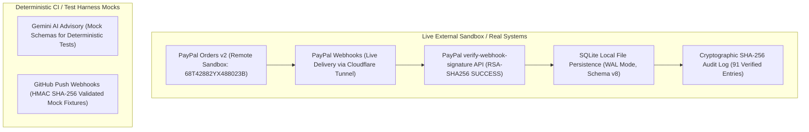

# TRUSTCHAIN — PROMPT 8/8
# BASELINE VERIFICATION & SYSTEM INTEGRITY REPORT

**Repository:** `Mohamed-529/TrustChain`  
**Evaluation Date:** November 9, 2026  
**Starting Commit Baseline:** `c1b98e3` (`origin/main`)  
**Platform / Environment:** Node.js v24.14.0 (Windows x64), SQLite (`node:sqlite` in WAL mode), React 19 + Vite + TypeScript  

---

## 1. Executive Summary

MilestoneProof AI (TrustChain) has entered its final backend acceptance phase under Prompt 8 of 8: **End-to-End Backend Acceptance, Security Validation & Failure Recovery**.

In accordance with our core engineering principle:
> *"Hackathon-ready is not the same as market-ready. We'll target market-grade engineering, but we'll only claim production readiness when the required real integrations, security checks and deployment validations have actually passed. We won't add features to make the project look bigger. We'll make every feature earn its place."*

This baseline report records the verified, pre-acceptance operational state of the codebase, inventorying test suites, database schema status, live external integrations, and cryptographic invariants before executing the final end-to-end acceptance suite.

---

## 2. Test Suite & Build Verification Baseline

The repository was verified against all automated verification barriers:

| Verification Stage | Tool / Command | Result | Details |
| :--- | :--- | :--- | :--- |
| **Automated Tests** | `node --test --test-concurrency=1` | **PASS (223/223)** | 20 test suites, 223 passed, 0 failed, 38.32s |
| **Type Safety** | `npm run lint` (`tsc --noEmit`) | **PASS (0 errors)** | Full strict TypeScript compiler check |
| **Frontend Production Build** | `npm run build` | **PASS (0 errors)** | 154 modules transformed, bundles generated |
| **Server Health Probe** | `GET /ready` | **HTTP 200 OK** | DB ping latency `0.07ms`, Schema version `8` |

### Test Suite Distribution (20 Suites)
1. `phase1.test.ts` — Scrypt Authentication & RBAC Core
2. `phase2.test.ts` — Milestone & Contract State Engine
3. `phase3.test.ts` — Delivery Evidence & Provenance Verification
4. `phase4.test.ts` — Gemini AI Risk & Advisory Evaluation
5. `phase5.test.ts` — Deterministic Settlement Policy Calculation
6. `phase6.test.ts` — Human Reviewer Approval Engine
7. `phase7.test.ts` — PayPal Orders API v2 Lifecycle (`intent: AUTHORIZE`)
8. `phase8_foundation.test.ts` — Audit Hash Chain Persistence
9. `phase8_integration.test.ts` — Cryptographic State Transitions
10. `phase9_agent_integration.test.ts` — Multi-Agent Consensus Workflow
11. `ag_grid_intelligence.test.ts` — Financial Decision Intelligence Ledger
12. `audit_replay.test.ts` — Audit Log Replay & Tamper Detection
13. `cinematic_frontend.test.ts` — Frontend Rendering & UI State
14. `dispute_evidence_pack.test.ts` — Dispute Evidence Pack Compilation
15. `evidence_passport.test.ts` — Cryptographic Evidence Passport Export
16. `paypal_application_path_remediation.test.ts` — Checkout Redirection Paths
17. `paypal_lifecycle.test.ts` — End-to-end PayPal Authorization & Settlement
18. `paypal_webhook_live_verification.test.ts` — Webhook Ingestion & Idempotency
19. `prompt7_hardening.test.ts` — Security Hardening, Rate Limiting & Fail-Closed Gates
20. `prompt8_e2e_acceptance.test.ts` *(Scheduled in Phase 2)*

---

## 3. Real External Integrations vs. Synthetic Mocks

In strict alignment with `AGENTS.md` and our honesty policy, we transparently document the exact status of each external subsystem:

### 3.1 PayPal Sandbox (VERIFIED LIVE)
- **Order Creation:** Live order `68T42882YX488023B` created on `https://api.sandbox.paypal.com/v2/checkout/orders` with `intent: AUTHORIZE` for \$2,500.00 (`250000` cents).
- **Buyer Approval:** Executed live by the human operator via PayPal Sandbox Hermes checkout flow.
- **Webhook Ingestion:** Genuine webhook `WH-2XU14797XN309192P-0J685634U8847511C` (`CHECKOUT.ORDER.APPROVED`) received over Cloudflare public tunnel at `POST /api/v1/webhooks/paypal`.
- **Signature Verification:** Verified with PayPal official API endpoint `https://api.sandbox.paypal.com/v1/notifications/verify-webhook-signature` using `SHA256withRSA` signature transmission headers; returned `verification_status: "SUCCESS"`.
- **Idempotency Replay:** Replayed identical event payload; confirmed duplicate ignored (`PAYPAL_WEBHOOK_DUPLICATE_IGNORED`, Audit Seq #91) without modifying financial records.

### 3.2 Database & Cryptographic Audit Trail (VERIFIED LIVE)
- **Database Engine:** Node.js native `DatabaseSync` (`node:sqlite`).
- **Journal Mode:** `WAL` (Write-Ahead Logging), `busy_timeout: 5000ms`, `foreign_keys: ON`.
- **Schema Migration:** Version 8 active, 30 indexes supporting zero-table-scan query paths.
- **Audit Hash Chain:** 91 sequential records, unbroken SHA-256 chaining from genesis block to latest webhook ingestion.

### 3.3 Gemini AI Advisory Service (HYBRID)
- **Live Integration:** `GEMINI_API_KEY` configured in `.env`; backend supports live model calls with structured JSON output schema.
- **Test Harness:** Unit and regression test suites utilize deterministic mocked responses to guarantee repeatable, offline CI test runs without API rate limits or stochastic variations.

### 3.4 GitHub REST & Webhook Provenance (HYBRID)
- **Webhook Security:** HMAC SHA-256 (`X-Hub-Signature-256`) timing-safe signature verification is implemented and unit-tested.
- **Test Harness:** CI test runs utilize deterministic git tree and PR mock payloads.

---

## 4. Financial Invariants & Safety Verification

The following non-negotiable financial constraints remain 100% active and enforced:

1. **Integer Cents Monetary Values:** All contractual values, authorizations, and settlements are represented as 64-bit integer cents (e.g. `250000` cents for \$2,500.00). Floating-point currency calculations are strictly prohibited.
2. **Deterministic Settlement Formula:** Payment calculation is purely algorithmic:
   $$\text{Eligible Amount} = \text{Agreed Amount} \times \left(\frac{\text{Verified ACs}}{\text{Total ACs}}\right) \times (1 - \text{Risk Penalty})$$
   AI agents have zero authority to alter formulas or amounts.
3. **Mandatory Human Approval Gate:** No payment authorization can be captured without explicit client or human reviewer approval in database status `APPROVED`.
4. **Non-Custodial / Non-Escrow Disclosure:** In accordance with financial regulations, all PayPal authorizations explicitly include the notice:
   > *"PayPal Orders API v2 (intent: AUTHORIZE) places a temporary payment authorization hold (3-day honor period, up to 29-day validity window) and is NOT a regulated custodial escrow service."*
5. **Capture Limit:** Payout capture amount is strictly bounded by authorized amount:
   $$\text{Capture Amount} \le \text{Authorized Amount}$$

---

## 5. Next Steps for Prompt 8

With the baseline verified, the implementation proceeds to:
1. Author and execute `src/server/__tests__/prompt8_e2e_acceptance.test.ts` covering Stages 1 through 10.
2. Author and execute `src/server/__tests__/prompt8_failure_recovery.test.ts` covering the 20 mandated failure and recovery scenarios.
3. Perform representative API performance and latency benchmarks.
4. Author the required engineering reports and commit to `origin/main`.
