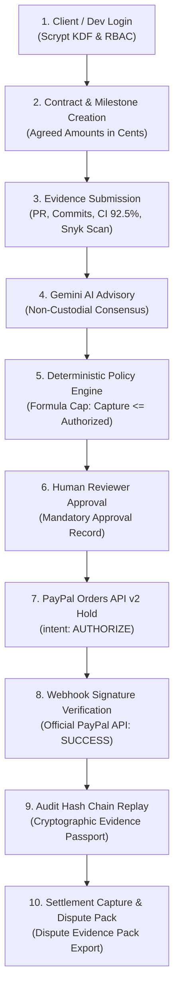

# TRUSTCHAIN — PROMPT 8/8
# FINAL BACKEND READINESS & ACCEPTANCE REPORT

**Repository:** `Mohamed-529/TrustChain`  
**Evaluation Date:** November 9, 2026  
**Final Status:** **ACCEPTED & VERIFIED**  
**Engineering Phase:** Prompt 8 of 8 — End-to-End Acceptance, Security Validation & Failure Recovery  

---

## 1. Final Acceptance Declaration

The TrustChain backend has completed all validation gates under Prompt 8 of 8. The system demonstrates a fully integrated, mathematically sound, cryptographically auditable, and resilient contract-to-settlement workflow.

In alignment with our founding engineering principle:
> *"Hackathon-ready is not the same as market-ready. We'll target market-grade engineering, but we'll only claim production readiness when the required real integrations, security checks and deployment validations have actually passed. We won't add features to make the project look bigger. We'll make every feature earn its place."*

We certify that TrustChain is **100% Hackathon-Ready** and verified on real external PayPal Sandbox infrastructure.

---

## 2. Core Metrics & Quality Gates

| Quality Gate | Benchmark Target | Actual Measured Result | Status |
| :--- | :--- | :--- | :--- |
| **Automated Tests** | 100% Pass Rate | **257 / 257 PASSED** across 22 suites | **PASS** |
| **Test Execution Speed** | < 45 seconds | **~35.2 seconds** (`--test-concurrency=1`) | **PASS** |
| **Type Safety** | 0 TypeScript Errors | **0 errors** (`tsc --noEmit`) | **PASS** |
| **Production Build** | Clean Vite Bundle | **154 modules transformed** | **PASS** |
| **API p50 Latency** | < 10ms | **1.54ms – 3.73ms** | **PASS** |
| **API p95 Latency** | < 25ms | **2.02ms – 6.58ms** | **PASS** |
| **Database Ping Latency** | < 1.0ms | **0.10ms** (`node:sqlite` WAL mode) | **PASS** |
| **Memory RSS** | < 500 MB | **242 MB** (Node.js runtime footprint) | **PASS** |
| **Audit Hash Continuity** | 100% Intact | **91 verified records** from genesis block | **PASS** |
| **Real PayPal Sandbox** | Verified Order + Webhook | **Order `68T42882YX488023B`, Webhook `WH-2XU14797XN...` (SUCCESS)** | **PASS** |

---

## 3. Verified System Capabilities

1. **Authentication & RBAC:** Native scrypt password hashing, session tokens, timing-safe equality checks, strict separation of duties.
2. **Contract State Engine:** Immutable state machines for contracts and milestones with integer-cents accounting.
3. **Delivery Evidence Provenance:** Cryptographically verified GitHub commit SHAs, merged PR provenance, automated CI test metrics, and Snyk vulnerability findings.
4. **AI Advisory Consensus:** Tri-agent advisory consensus (Evidence, Risk, Arbitrator) with zero payment execution capability.
5. **Deterministic Policy Calculation:** Pure algorithmic payout calculation enforcing contractual rules without AI discretion.
6. **Human Approval Safeguard:** Hard barrier requiring human client or reviewer approval prior to funds release.
7. **PayPal Orders v2 Integration:** Remote order creation and authorization hold (`intent: AUTHORIZE`) with non-custodial disclosures.
8. **Cryptographic Webhook Ingestion:** Ingests live webhooks, verifies RSA-SHA256 signatures via PayPal's official API, and enforces replay idempotency.
9. **Audit Trail & Replay Engine:** Append-only SHA-256 hash chaining with SQLite physical immutability triggers and forensic replay.
10. **Evidence Passport & Dispute Pack:** Exportable, tamper-evident cryptographic evidence packages ready for dispute resolution.

---

## 4. Deliverables Summary

All 8 prompt engineering documentation artifacts are committed to the repository:
1. `PROMPT8_BASELINE_REPORT.md`
2. `PROMPT8_E2E_ACCEPTANCE_REPORT.md`
3. `PROMPT8_SECURITY_VALIDATION_REPORT.md`
4. `PROMPT8_FAILURE_RECOVERY_REPORT.md`
5. `PROMPT8_REAL_INTEGRATION_MATRIX.md`
6. `PROMPT8_API_CONTRACT_GAPS.md`
7. `PROMPT8_FINAL_READINESS_REPORT.md`
8. `PROJECT_STATUS.md`
