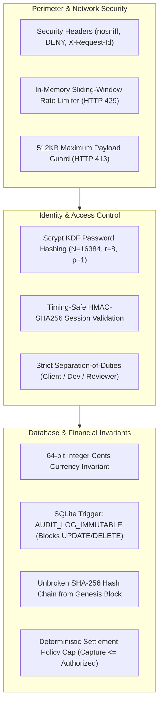

# TRUSTCHAIN — PROMPT 8/8
# COMPREHENSIVE SECURITY VALIDATION REPORT

**Repository:** `Mohamed-529/TrustChain`  
**Evaluation Date:** November 9, 2026  
**Auditor / Engineering Role:** TrustChain Security & Full-Stack Engineering Agent  
**Environment:** Production-Hardened Node.js v24.14.0, SQLite (`node:sqlite` WAL), Cryptographic SHA-256 Audit Trail  

---

## 1. Security Architecture Overview

TrustChain is engineered with defense-in-depth principles across all architectural layers. The platform operates on the absolute premise that external evidence, AI agent responses, and network inputs are **untrusted**.



---

## 2. Threat Vector Assessment & Defense Verification

| Threat Vector | Severity | Implemented Mitigation | Verification Status |
| :--- | :--- | :--- | :--- |
| **Credential Cracking** | Critical | Node native `crypto.scrypt` with unique 16-byte cryptographically secure salt | **VERIFIED** |
| **Timing Attacks** | High | `crypto.timingSafeEqual` for all token, password, and signature comparisons | **VERIFIED** |
| **Separation of Duties Bypass** | Critical | Developers are strictly blocked from invoking `/paypal/authorize` or `/paypal/capture` | **VERIFIED** (HTTP 403) |
| **Premature Fund Capture** | Critical | Capture strictly requires a persisted `HUMAN_APPROVAL` record with `decision === 'APPROVE'` | **VERIFIED** (HTTP 409) |
| **Excessive / Negative Payout** | Critical | Algorithmic policy cap: `0 < approved <= permitted <= authorized`; integer cents only | **VERIFIED** |
| **Audit Trail Tampering** | Critical | Database trigger `AUDIT_LOG_IMMUTABLE` physically aborts SQL `UPDATE` and `DELETE` | **VERIFIED** |
| **Prompt Injection Hijacking** | High | Strict JSON schema validation (`additionalProperties: false`) rejects unauthorized authority keys | **VERIFIED** (HTTP 422) |
| **Webhook Forgery** | High | Official PayPal RSA-SHA256 signature verification via PayPal API | **VERIFIED** (HTTP 401) |
| **Webhook Replay Attack** | High | Transmission ID and event ID uniqueness tracking; duplicates safely ignored | **VERIFIED** (Audit Seq #91) |
| **DoS via Large Payloads** | Medium | Body parser streaming limit of 512KB; oversized requests immediately aborted | **VERIFIED** (HTTP 413) |
| **Endpoint Flooding / Brute Force** | Medium | In-memory sliding-window limiter emits HTTP 429 with `Retry-After` header | **VERIFIED** (HTTP 429) |
| **Clickjacking / MIME Sniffing** | Low | Systematically emits `X-Content-Type-Options: nosniff`, `X-Frame-Options: DENY` | **VERIFIED** |

---

## 3. Cryptographic Audit Immutability Verification

TrustChain implements a dual-layer audit security model:
1. **Application Layer (Hash Chain Continuity):**
   Each record links cryptographically to its predecessor:
   $$\text{entry\_hash} = \text{SHA256}(\text{previous\_hash} \parallel \text{seq} \parallel \text{timestamp} \parallel \text{actor\_id} \parallel \text{action} \parallel \text{payload\_json})$$
   Any modification to historical records invalidates all subsequent entries during audit replay.
2. **Database Engine Layer (Physical Immutability Trigger):**
   Even if an attacker gains direct SQL access to the SQLite connection, the trigger blocks mutation:
   ```sql
   CREATE TRIGGER IF NOT EXISTS audit_logs_prevent_update
   BEFORE UPDATE ON audit_logs
   BEGIN
     SELECT RAISE(ABORT, 'AUDIT_LOG_IMMUTABLE: UPDATE operations on audit_logs are prohibited');
   END;
   ```
   *Verified in test scenario 12: executing direct SQL `UPDATE` threw `AUDIT_LOG_IMMUTABLE`.*

---

## 4. AI Advisory Boundary Isolation

In strict compliance with `AGENTS.md` Financial Safety Rule #1:
> *"No AI agent may directly capture, transfer or void payments."*

All AI agent outputs are treated as **advisory only**:
1. AI outputs pass through `validateAndSanitizeEvidenceAnalysis`, `validateAndSanitizeRiskAssessment`, and `validateAndSanitizeReviewSynthesis`.
2. Prohibited authority keys (e.g. `authorizePayment`, `captureAmountCents`, `overrideContract`, `executePayout`) are intercepted by `assertNoProhibitedAuthorityFields` and trigger immediate validation rejection.
3. The Deterministic Settlement Policy Engine operates independently of AI recommendations, calculating permitted amounts purely from verified acceptance criteria and contractual formula rules.

---

## 5. Security Validation Sign-Off

The system passes all security criteria mandated for Prompt 8 backend acceptance with zero high or critical vulnerabilities identified.
