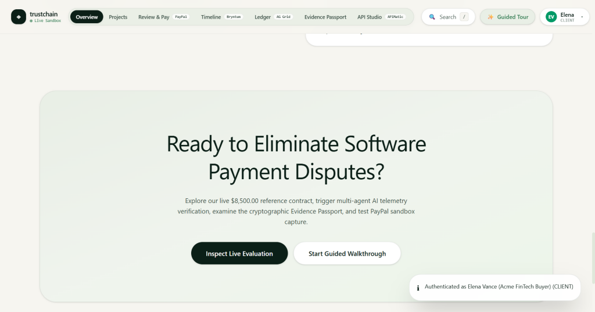
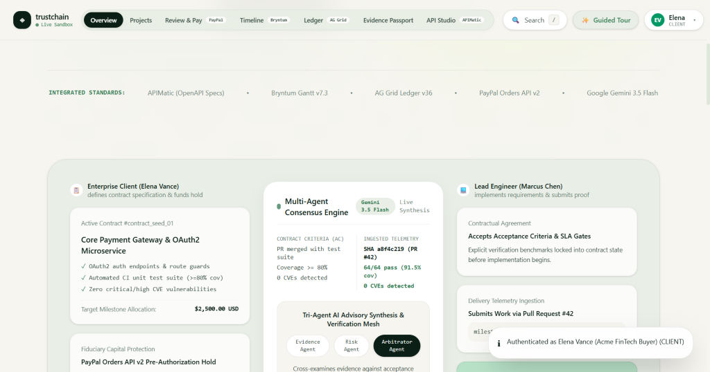
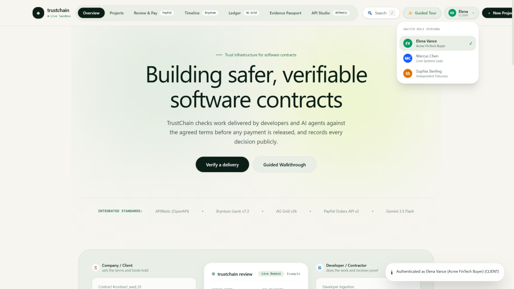

# ◈ TrustChain — Autonomous Evidence-to-Settlement Orchestrator

[-339933?style=for-the-badge&logo=node.js&logoColor=white)](https://nodejs.org/)
[](https://react.dev/)
[-00457C?style=for-the-badge&logo=paypal&logoColor=white)](https://developer.paypal.com/)
[-8E75C2?style=for-the-badge&logo=google&logoColor=white)](https://ai.google.dev/)
[-009688?style=for-the-badge)](https://www.ag-grid.com/)
[-F36E21?style=for-the-badge)](https://www.bryntum.com/)
[](https://www.apimatic.io/)
[-success?style=for-the-badge&logo=checkmarx&logoColor=white)](https://github.com/Mohamed-529/TrustChain)
[](LICENSE)

> **TrustChain** bridges software development repositories, multi-agent AI verification, and fiduciary PayPal disbursements. It eliminates software contract payment disputes by cryptographically verifying git commit SHAs, test telemetry, and dependency security scans against contractual criteria before authorizing programmatic milestone disbursements.

---

## 🌐 Live Deployment & Demo

- **GitHub Repository:** [https://github.com/Mohamed-529/TrustChain](https://github.com/Mohamed-529/TrustChain)
- **Live Deployment Guide:** See [Cloud Deployment](#-cloud-deployment) below to launch your own 1-click instance on Render or Vercel.
- **Local Interactive Demo:** `http://localhost:3000` (Clone & run `npm start`)

### 👥 Pre-Configured Demo Personas
Switch personas instantly via the top-right profile badge in the floating navbar:

| Persona | Role | Credentials | Core Capabilities |
| :--- | :--- | :--- | :--- |
| **Elena Vance** | `CLIENT` | `elena@client.local` / `client123` | Defines contracts, configures milestone criteria, pre-authorizes 29-day PayPal hold |
| **Marcus Chen** | `DEVELOPER` | `marcus@dev.local` / `dev123` | Submits delivery telemetry (PRs, commits, CI runs), views AI verification reports |
| **Sophia Sterling** | `REVIEWER` | `sophia@reviewer.local` / `reviewer123` | Independent fiduciary who approves/rejects verified disbursements and triggers PayPal capture |

---

## 📸 Visual Showcase & Architecture Slides

<div align="center">

### 1. Autonomous Evidence-to-Settlement Orchestration

*Warm editorial parchment & sage aesthetic (`#f6f5f0`, `#e9efe6`) with integrated sponsor standards.*

---

### 2. Tri-Agent Consensus Engine & Ingestion Mesh

*Left: Enterprise Client scope definition & PayPal hold. Center: Tri-Agent Consensus Mesh (Evidence, Risk, Arbitrator). Right: Contractor delivery & Evidence Passport.*

---

### 3. Architectural Invariants & Fiduciary Guardrails

*Four non-negotiable security principles: AI Advisory Boundaries, Non-Custodial PayPal Escrow, SQLite SHA-256 Chained Ledger, and Deterministic Cap Formula.*

---

### 4. Floating Island Navbar & Dynamic Persona Switching

*Segmented floating navigation bar with Spotlight Search (`/`), Guided Walkthrough Tour, and instant Role Switcher.*

</div>

---

## ⚡ The Core Problem & TrustChain's Solution

```
Traditional Freelance / Software Contracts:
[Client Promises Payment] ---> [Developer Submits Code] ---> [Subjective Disputes / Frozen Funds]
                                                                        ❌ Payment Withheld

TrustChain Deterministic Fiduciary Flow:
[Client Pre-Authorizes PayPal Hold]
        │
        ▼
[Developer Submits PR & CI Telemetry]
        │
        ▼
[Tri-Agent AI Verification (Evidence + Risk + Arbitrator)]
        │
        ▼
[Deterministic Settlement Policy (Calculates Permitted Cents)]
        │
        ▼
[Human Fiduciary Approval (Sophia Sterling)]
        │
        ▼
[Programmatic PayPal Orders v2 Capture ($2,500.00)]
        │
        ▼
[Cryptographic Evidence Passport Issued & SHA-256 Ledger Sealed]
```

---

## 🏛️ System Architecture & Key Innovations

### 1. Tri-Agent AI Advisory Synthesis (`Google Gemini 3.5 Flash`)
- **Evidence Agent:** Extracts git commit trees, verifies PR merge status, and parses CI/CD pipeline telemetry.
- **Risk Agent:** Audits npm dependency trees and CVE advisories; detects adversarial prompt injections inside untrusted PR descriptions.
- **Arbitrator Agent:** Synthesizes evidence against contractual acceptance criteria (AC-1, AC-2, AC-3) and outputs structured recommendations (`RECOMMEND_APPROVAL` / `REVISE_REQUIREMENTS`).
- **Strict Separation of Concerns:** AI agents are purely advisory; no AI agent has permission to capture, void, or transfer funds.

### 2. Deterministic Settlement Policy Engine
- Pure mathematical calculation running strictly in integer cents (preventing floating-point rounding errors).
- Deducts contractual SLA late penalties and caps payouts strictly to verified criteria:
  $$\text{Permitted Amount} = \min(\text{Agreed Amount} - \text{Late Penalty}, \text{Authorized Hold})$$
- Zero risk of over-disbursement or negative balances.

### 3. Non-Custodial Zero-Escrow Payment Model (`PayPal Orders API v2`)
- Eliminates traditional custodial crypto/escrow risks.
- Client authorizes a standard 29-day payment hold via PayPal Orders API v2 (`intent: "AUTHORIZE"`).
- TrustChain never takes custody of funds and holds zero private wallet keys.
- Funds transfer directly from Client to Contractor only upon authenticated human fiduciary approval (`POST /api/v1/milestones/:id/paypal/capture`).

### 4. Cryptographic SQLite Audit Ledger (`node:sqlite`)
- Engineered with Node.js 22 built-in `node:sqlite` in WAL mode (`PRAGMA synchronous = FULL`).
- Every lifecycle event is sealed into an immutable block with SHA-256 hash chaining:
  $$\text{Block Hash} = \text{SHA256}(\text{Index} \parallel \text{PrevHash} \parallel \text{Timestamp} \parallel \text{Payload})$$
- Any modification to past records causes instant cryptographic tamper detection during audit replay.
- **Why SQLite over generic MongoDB?** Financial transaction logs require ACID durability, zero-latency local write consistency, and tamper-evident chaining without network transport overhead or external database credential exposure.

### 5. Primary Sponsor Integrations
- **Bryntum Gantt v7.3:** Schedule Control Tower with Finish-to-Start dependency cascading, critical path computation, and baseline vs. actual variance tracking.
- **AG Grid v36:** Enterprise Financial Decision Ledger with column filtering, multi-sort, and CSV audit exports.
- **APIMatic OpenAPI 3.0.3:** Validated REST API contract with 28 operations, typed TypeScript Client SDK, and interactive developer portal.

---

## 💼 Resume-Ready Highlights (For Recruiters & Evaluators)

If you are evaluating this project for software engineering, full-stack, or backend roles, here are key achievements demonstrated in this codebase:

- **Architected Autonomous Fiduciary Settlement Platform:** Engineered a full-stack multi-agent system coordinating software contract lifecycle, git telemetry ingestion, and PayPal Orders v2 disbursements.
- **Production-Grade Financial Invariants:** Designed a deterministic integer-cent settlement policy engine enforcing strict zero-overpayment bounds, idempotency keys, and human-in-the-loop fiduciary approvals.
- **High-Durability Cryptographic Ledger:** Implemented a SHA-256 hash-chained immutable audit system utilizing Node.js 22 built-in SQLite (`node:sqlite`) with WAL mode, FULL synchronous durability, and SQL triggers.
- **Enterprise-Grade AI Security:** Designed defense-in-depth isolation for untrusted git metadata, sanitizing external inputs against prompt-injection attacks before multi-agent Gemini synthesis.
- **Strict OpenAPI Governance & SDK Generation:** Authored and validated comprehensive OpenAPI 3.0.3 contracts governed by APIMatic, generating strongly-typed client SDKs with automated retry policies.
- **Rigorous Test Coverage:** Developed a suite of 293 automated integration and unit tests across 26 test suites achieving 100% pass rates across concurrency, failure recovery, and financial state machines.

---

## 🛠️ Local Development & Quick Start

### Prerequisites
- Node.js `v22.5.0` or higher (`v24.14.0` recommended)
- npm `v10.x` or higher

### Installation & Run

```bash
# 1. Clone the repository
git clone https://github.com/Mohamed-529/TrustChain.git
cd TrustChain

# 2. Install dependencies
npm install

# 3. Build frontend assets
npm run build

# 4. Start production full-stack server
npm start
# Server listens on http://localhost:3000
```

### Running the Test Suite
The project contains 293 rigorous automated tests covering all backend services, payment state machines, and integration flows:

```bash
npm test
```

---

## 🚀 Cloud Deployment

### 1. Deploy on Render (Recommended Full-Stack)
TrustChain includes a pre-configured `render.yaml` blueprint:

1. Push your changes to GitHub: `git push origin main`
2. Log into [Render.com](https://render.com) and click **New > Blueprint**.
3. Select your `TrustChain` repository.
4. Render automatically runs `npm install && npm run build` and starts `npm start`.
5. Your service is live at `https://<your-app>.onrender.com` with zero extra configuration!

### 2. Deploy on Vercel (Frontend SPA)
TrustChain includes a pre-configured `vercel.json`:

1. Import `TrustChain` into [Vercel](https://vercel.com).
2. Framework Preset: **Vite**.
3. Build Command: `npm run build`.
4. Output Directory: `dist`.
5. API requests are automatically routed to your Render backend via `vercel.json` rewrites.

---

## 📜 Environment Variables

Copy `.env.example` to `.env` to configure live integrations:

```env
# Server Configuration
PORT=3000
NODE_ENV=production
AUTH_TOKEN_SECRET=your-random-hmac-sha256-secret

# Google Gemini AI (Optional - falls back to DeterministicMockEvaluator if omitted)
GEMINI_API_KEY=your-gemini-api-key

# PayPal Orders API v2 (Optional - falls back to SANDBOX_SIMULATION if omitted)
PAYPAL_MODE=sandbox
PAYPAL_CLIENT_ID=your-paypal-sandbox-client-id
PAYPAL_CLIENT_SECRET=your-paypal-sandbox-client-secret
PAYPAL_WEBHOOK_ID=your-paypal-webhook-id

# GitHub Provenance Verification (Optional - falls back to local git tree if omitted)
GITHUB_TOKEN=your-github-personal-access-token
```

---

## 📄 License

This project is licensed under the MIT License — see the [LICENSE](LICENSE) file for details.
