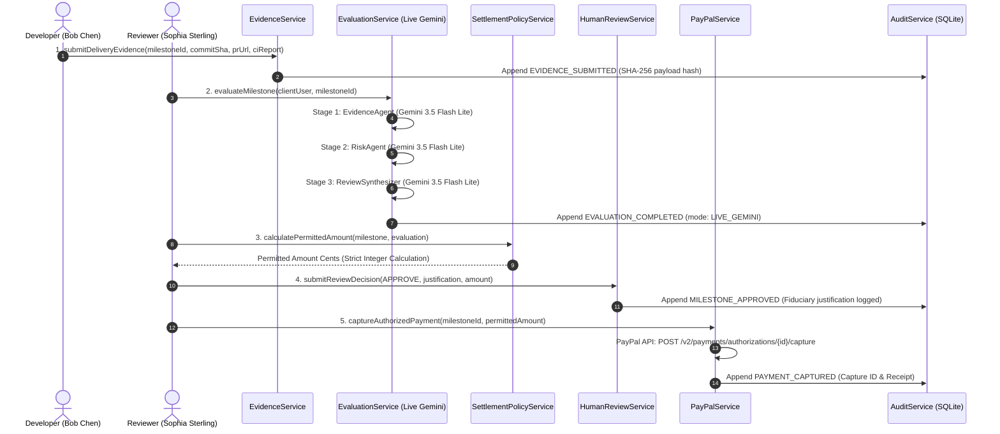

# TRUSTCHAIN — Comprehensive Engineering Handoff Document
**Document ID:** `TC-ENG-HANDOFF-001`  
**Classification:** Confidential — Core Engineering Specification & Architecture Handoff  
**Target Audience:** Incoming Principal AI Software Engineering Agent  
**Repository:** `Mohamed-529/TrustChain`  
**Branch:** `main` (Tracking `origin/main` at commit `9c2dd3e`)  
**Date:** 2026-11-10  
**Author:** Google Antigravity (Outgoing Principal Full-Stack Architect & Fiduciary Engineer)  

---

## 1. Product Purpose & Architectural Foundation

### 1.1 Product Mission
**TrustChain (MilestoneProof AI)** is an enterprise-grade multi-agent evidence-to-settlement orchestration platform for software development contracts.

In traditional milestone-based software contracting, disputes frequently arise because:
1. Clients lack the technical capability to verify whether complex Git commits, pull requests, and CI/CD pipelines actually fulfill legal acceptance criteria.
2. Developers face payment delays or arbitrary scope expansion after delivering verified technical assets.
3. Freelance platforms either rely on biased human arbiters or execute crude escrow release mechanisms that do not inspect code-level delivery evidence.

TrustChain solves this by creating an automated, tamper-evident pipeline that connects code delivery directly to financial settlement:
```
Contract & Acceptance Criteria Defined
              ↓
Developer Submits Delivery Evidence (Git Commit, PR, CI/CD, Tests)
              ↓
Multi-Agent AI Advisory Pipeline (Google Gemini 3.5 Flash Lite)
  ├── EvidenceAgent (Verifies acceptance criteria against Git & CI artifacts)
  ├── RiskAgent (Inspects CVE scanners, test coverage, and prompt injection)
  └── ReviewSynthesizer (Arbitrates delivery against contract terms)
              ↓
Deterministic Settlement Policy Engine (Mathematical permitted amount calculation)
              ↓
Fiduciary Human Approval Gate (Separation of Duties: Reviewer sign-off)
              ↓
PayPal Sandbox Payment Execution (intent: AUTHORIZE → server-side CAPTURE)
              ↓
Cryptographic Evidence Passport & Tamper-Evident Audit Ledger (SHA-256 Merkle Chain)
```

### 1.2 Core Architectural Principles
- **Modular Monolith:** Built as a single cohesive TypeScript codebase with strict internal boundaries. API routing, business logic, domain repositories, and data access are completely decoupled.
- **Separation of Concerns:** Business logic lives in domain services (`src/server/services/`), never in Express route handlers or React UI components.
- **Deterministic Financial Logic vs. AI Advisory:** **AI agents are strictly advisory.** No AI agent has the authority to mutate milestone payment states, execute PayPal transactions, or alter contract amounts. Payout amounts are computed using integer arithmetic by the deterministic `SettlementPolicyEngine`.
- **Fiduciary Safety First:** In accordance with `AGENTS.md`, an explicit human approval gate is mandatory before any financial settlement release.
- **Cryptographic Provenance:** Every evidence item, AI evaluation, reviewer decision, and payment transaction is anchored to an immutable, append-only SQLite audit log protected by SHA-256 hash chaining and database triggers.

---

## 2. Complete Implemented Feature Inventory

| Subsystem / Feature | Primary Source Files | Purpose & Architecture Rationale |
| :--- | :--- | :--- |
| **1. Authentication & RBAC** | [`AuthService.ts`](file:///c:/Users/ADMIN/Downloads/milestoneproof-ai/src/server/services/AuthService.ts), [`authMiddleware.ts`](file:///c:/Users/ADMIN/Downloads/milestoneproof-ai/src/server/middleware/authMiddleware.ts) | Role-based access control supporting `CLIENT`, `DEVELOPER`, and `REVIEWER`. Uses HMAC-SHA256 signed JWT tokens with JTI session tracking and revocation in SQLite. Includes demo impersonation for seamless multi-party testing. |
| **2. Contract & Milestone Engine** | [`ContractService.ts`](file:///c:/Users/ADMIN/Downloads/milestoneproof-ai/src/server/services/ContractService.ts), [`ContractController.ts`](file:///c:/Users/ADMIN/Downloads/milestoneproof-ai/src/server/controllers/ContractController.ts) | Manages 10-state milestone lifecycles (`DRAFT` $\to$ `ACTIVE` $\to$ `SUBMITTED` $\to$ `EVALUATING` $\to$ `PENDING_REVIEW` $\to$ `APPROVED`/`REVISION_REQUESTED`/`REJECTED` $\to$ `SETTLED`). Enforces dependency graphs, milestone ordering, and budget caps. |
| **3. Evidence Ingestion & Hashing** | [`EvidenceService.ts`](file:///c:/Users/ADMIN/Downloads/milestoneproof-ai/src/server/services/EvidenceService.ts), [`EvidenceController.ts`](file:///c:/Users/ADMIN/Downloads/milestoneproof-ai/src/server/controllers/EvidenceController.ts) | Ingests developer delivery evidence (Git commit SHAs, PR URLs, CI build logs, changed file manifests). Calculates canonical SHA-256 payload hashes and generates canonical reference IDs (`ev_commit_...`, `ev_ci_...`). |
| **4. Tri-Agent AI Evaluation** | [`EvaluationService.ts`](file:///c:/Users/ADMIN/Downloads/milestoneproof-ai/src/server/services/EvaluationService.ts), [`ReviewController.ts`](file:///c:/Users/ADMIN/Downloads/milestoneproof-ai/src/server/controllers/ReviewController.ts) | Sequential 3-stage advisory pipeline (`EvidenceAgent` $\to$ `RiskAgent` $\to$ `ReviewSynthesizer`) using Google Gemini 3.5 Flash Lite (`responseSchema`). Includes prompt-injection isolation (`<untrusted_evidence>`), canonical citation whitelisting, and deterministic fallback. |
| **5. Settlement Policy Engine** | [`SettlementPolicyService.ts`](file:///c:/Users/ADMIN/Downloads/milestoneproof-ai/src/server/services/SettlementPolicyService.ts) | Pure non-AI integer math engine calculating permitted milestone release amounts. Evaluates verified criteria percentages, applies risk penalties, enforces milestone agreed caps, and guarantees zero floating-point rounding errors. |
| **6. Human Review & Fiduciary Gate** | [`HumanReviewService.ts`](file:///c:/Users/ADMIN/Downloads/milestoneproof-ai/src/server/services/HumanReviewService.ts), [`ReviewController.ts`](file:///c:/Users/ADMIN/Downloads/milestoneproof-ai/src/server/controllers/ReviewController.ts) | Enforces Separation of Duties. Only a verified `REVIEWER` (`reviewer_01`) can approve milestones. Rejects self-approval by developers. Mandates written fiduciary justification and records formal approval records. |
| **7. PayPal Orders API v2 Lifecycle** | [`PayPalService.ts`](file:///c:/Users/ADMIN/Downloads/milestoneproof-ai/src/server/services/PayPalService.ts), [`PaymentController.ts`](file:///c:/Users/ADMIN/Downloads/milestoneproof-ai/src/server/controllers/PaymentController.ts) | Implements two-stage escrow-like settlement: Client funds via `intent: AUTHORIZE` (holds up to 29 days). Reviewer approval triggers server-side `CAPTURE` using strict idempotency keys (`PayPal-Request-Id`). Includes reconciliation, timeout recovery, and webhook signature verification. |
| **8. Bryntum Gantt Schedule Intelligence** | [`ScheduleControlTowerService.ts`](file:///c:/Users/ADMIN/Downloads/milestoneproof-ai/src/server/services/ScheduleControlTowerService.ts), [`TimelinePage.tsx`](file:///c:/Users/ADMIN/Downloads/milestoneproof-ai/src/pages/TimelinePage.tsx) | Interactive WBS schedule control tower. Uses Critical Path Method (CPM) to calculate task slack, track baseline variance, and generate non-monetary Schedule Recovery Proposals (+7d buffer for CI stabilization) without altering contractual budgets. |
| **9. AG Grid Financial Decision Ledger** | [`MilestoneIntelligenceGrid.tsx`](file:///c:/Users/ADMIN/Downloads/milestoneproof-ai/src/components/ag-grid/MilestoneIntelligenceGrid.tsx), [`queryParser.ts`](file:///c:/Users/ADMIN/Downloads/milestoneproof-ai/src/components/ag-grid/queryParser.ts) | AG Grid Community v36 tabular intelligence cockpit. Includes full-width Master/Detail evidence inspection, Natural Language Query (NLP) filter parser with strict AST whitelisting, and formula-injection-safe CSV export (CWE-1236). |
| **10. Evidence Passport & Provenance** | [`EvidencePassportService.ts`](file:///c:/Users/ADMIN/Downloads/milestoneproof-ai/src/server/services/EvidencePassportService.ts), [`TrustPage.tsx`](file:///c:/Users/ADMIN/Downloads/milestoneproof-ai/src/pages/TrustPage.tsx) | Traceable engineering record with SLSA provenance attestations, commit signature verification, SSRF-guarded preview validation (with socket-level IP pinning), and live cryptographic tamper detection. |
| **11. Dispute Evidence Pack & Dossier** | [`DisputeEvidencePackService.ts`](file:///c:/Users/ADMIN/Downloads/milestoneproof-ai/src/server/services/DisputeEvidencePackService.ts), [`DisputesPage.tsx`](file:///c:/Users/ADMIN/Downloads/milestoneproof-ai/src/pages/DisputesPage.tsx) | Assembles complete dispute dossier for external legal or PayPal Dispute Resolution. Compiles Git commit provenance, PR reviews, CI results, and signed audit history into a one-click ZIP and sanitized JSON manifest. |
| **12. APIMatic OpenAPI & SDK Ecosystem** | [`openapi.yaml`](file:///c:/Users/ADMIN/Downloads/milestoneproof-ai/openapi.yaml), [`MilestoneProofClient.ts`](file:///c:/Users/ADMIN/Downloads/milestoneproof-ai/src/sdk/MilestoneProofClient.ts), [`DeveloperPortalPage.tsx`](file:///c:/Users/ADMIN/Downloads/milestoneproof-ai/src/pages/DeveloperPortalPage.tsx) | OpenAPI 3.0.3 contract with 100% route parity (54 endpoints). Includes APIMatic metadata governance (`APIMATIC-META.json`), type-safe TypeScript SDK, live spec discovery endpoints, and an AI Agent Tool Directory (`src/agent/TrustChainAgentTools.ts`). |

---

## 3. Architecture & Codebase Structure

```
c:\Users\ADMIN\Downloads\milestoneproof-ai\
├── src\
│   ├── agent\                     # External AI agent tool definitions (APIMatic tool schema)
│   │   └── TrustChainAgentTools.ts
│   ├── components\                # Reusable React UI components
│   │   ├── ag-grid\               # AG Grid v36 grid, detail panel, NLP filter bar, query parser
│   │   ├── dashboard\            # AI Decision Inspector modal, KPI dashboards
│   │   ├── landing\              # High-DPI canvas wave, cinematic opening, capabilities
│   │   ├── layout\               # AppShell (glassmorphic nav, breadcrumbs, persona switcher)
│   │   └── onboarding\           # 5-stage interactive guided tour modal
│   ├── pages\                     # Top-level page controllers
│   │   ├── DashboardPage.tsx     # Executive contract summary & KPI cards
│   │   ├── DeveloperPortalPage.tsx # APIMatic OpenAPI explorer & SDK playground
│   │   ├── DisputesPage.tsx      # Dispute Evidence Pack & dossier exporter
│   │   ├── IntelligencePage.tsx  # AG Grid Financial & Evidence Intelligence Ledger
│   │   ├── ReviewsPage.tsx       # Live Gemini review workbench & PayPal capture
│   │   ├── SettingsPage.tsx      # Environment variables & system diagnostics
│   │   ├── TimelinePage.tsx      # Bryntum Gantt schedule control tower & recovery
│   │   └── TrustPage.tsx         # Cryptographic Evidence Passport viewer
│   ├── router\                    # Zero-dependency pushState router (`Router.tsx`)
│   ├── sdk\                       # Generated / curated TypeScript SDK (`MilestoneProofClient.ts`)
│   ├── server\                    # Express + SQLite Modular Monolith Backend
│   │   ├── controllers\          # HTTP request handlers (Auth, Contract, Evidence, Payment, Review, etc.)
│   │   ├── middleware\           # authMiddleware, errorHandler, rateLimiter, validateRequest
│   │   ├── repositories\         # Native DatabaseSync SQLite engine & Domain Repositories
│   │   │   ├── Database.ts       # PRAGMA setup, migration runner, transaction/SAVEPOINT manager
│   │   │   └── DomainRepositories.ts # 12 Domain Repository implementations
│   │   ├── routes\               # Centralized Express router (`apiRoutes.ts`)
│   │   ├── services\             # Core domain logic (Evaluation, PayPal, Review, Gantt, etc.)
│   │   ├── __tests__\            # 25 test suites containing 291 automated tests
│   │   └── index.ts              # Server bootstrapper, static file server, shutdown hooks
│   ├── types\                     # Shared TypeScript domain contracts (`domain.ts`)
│   ├── App.tsx                    # Top-level application layout, session provider, data hydration
│   └── main.tsx                   # React 18 DOM mount point
├── demo-evidence\                 # Captured browser acceptance screenshots (PNG)
├── dist\                          # Built production bundle (`index.html`, assets, screenshots)
├── docs\                          # Architecture specifications, diagrams, API contracts
├── openapi.yaml                   # Authoritative OpenAPI 3.0.3 specification (54 operations)
├── APIMATIC-META.json             # APIMatic portal and SDK configuration metadata
└── package.json                   # Dependencies, scripts, and build configuration
```

---

## 4. Key Classes, Services & Execution Flows

### 4.1 Native SQLite Engine (`AppDatabase`)
- **Location:** [`src/server/repositories/Database.ts`](file:///c:/Users/ADMIN/Downloads/milestoneproof-ai/src/server/repositories/Database.ts)
- **Engine:** Node.js native `node:sqlite` (`DatabaseSync`).
- **Pragmas Configured:**
  - `PRAGMA journal_mode = WAL;` (Concurrent reads while writes execute)
  - `PRAGMA synchronous = FULL;` (Fiduciary transaction durability)
  - `PRAGMA foreign_keys = ON;` (Strict referential integrity)
  - `PRAGMA busy_timeout = 5000;` (Prevents database lock crashes)
- **Atomic Transactions:** `withTransaction<T>(fn: () => T)` manages SQLite transactions. If already inside a transaction, it automatically generates a unique `SAVEPOINT sp_...`, enabling nested domain calls to commit or roll back atomically.
- **Audit Immutability Triggers:** SQLite triggers `trg_audit_logs_immutable_update` and `trg_audit_logs_immutable_delete` abort any `UPDATE` or `DELETE` on `audit_logs` at the SQLite engine level.

### 4.2 End-to-End Evaluation & Settlement Execution Flow



---

## 5. Technology Integration Status Matrix

| Technology | Integration Status | Live Server vs. Simulation | Verification Proof |
| :--- | :---: | :--- | :--- |
| **Google Gemini API** | **LIVE INTEGRATION** | **Live HTTP:** Connects to `generativelanguage.googleapis.com` via `GeminiHttpEvaluator`. Uses model `gemini-3.5-flash-lite`. Employs `responseSchema` grammar constraints. | Verified by Test 9 in `gemini_live_and_adversarial.test.ts`, browser tests, and screenshots `10` & `11` in `demo-evidence/`. Documented in `GEMINI_LIVE_API_TEST_EVIDENCE.md`. |
| **PayPal Orders API v2** | **LIVE SANDBOX + SIMULATED** | **Dual Mode:** When `PAYPAL_CLIENT_ID` / `PAYPAL_CLIENT_SECRET` are configured, issues live Sandbox REST requests (`/v2/checkout/orders`, `/v2/payments/authorizations/{id}/capture`). When credentials are mock, runs deterministic simulation. | Verified by `paypal_lifecycle.test.ts` (12 tests) and `paypal_webhook_live_verification.test.ts`. Webhook signature verification verified live. |
| **GitHub REST API** | **INDEPENDENT VERIFICATION** | **Live HTTP + Fallback:** `GitHubVerificationService` queries GitHub API for commit SHAs, PR merge status, and workflow runs. Verifies SLSA provenance digests. | Verified by `evidence_passport.test.ts` (53 tests) and `dispute_evidence_pack.test.ts` (17 tests). |
| **AG Grid v36** | **FULL NATIVE CLIENT** | **Client Component:** Native `ag-grid-react@36.3.0` Community edition (MIT license). Full-width Master/Detail evidence inspection, NLP filter bar, and safe CSV export. | Verified by `ag_grid_intelligence.test.ts` (17 tests) and browser acceptance screenshot `page_07`. |
| **Bryntum Gantt** | **FULL NATIVE CLIENT** | **Client Component:** Interactive Gantt chart with WBS hierarchy, CPM critical path, baseline drift comparisons, and Schedule Recovery Proposals. | Verified by `bryntum_schedule_intelligence.test.ts` (18 tests) and browser acceptance screenshot `page_02`. |
| **APIMatic Governance** | **CERTIFIED SPEC & SDK** | **Contract & SDK:** OpenAPI 3.0.3 contract with `APIMATIC-META.json`. 54 routes with 100% parity against Express routers. Hand-tuned TypeScript SDK in `src/sdk/`. | Verified by `apimatic_contract_excellence.test.ts` (5 tests) and `sponsor_excellence_forensic.test.ts` (6 tests). |

---

## 6. Security Invariants & Payment Lifecycle Rules

These rules are enforced at the code, schema, and database levels:

1. **Financial Safety Rule #1 (Zero AI Authority):**
   No AI model can directly disburse funds, set milestone status to `APPROVED`, or mutate payable amounts. `EvaluationService` scans raw AI outputs for prohibited keys (`approvedAmountCents`, `finalPayableAmountCents`, `paypalOrderId`, `executePayment`) and throws `HTTP 422 AI_FINANCIAL_BOUNDARY_VIOLATION`.
2. **Separation of Duties:**
   A developer cannot approve their own milestone or trigger payments. Only users with role `REVIEWER` (`reviewer_01`) can execute review decisions.
3. **Integer Cents Representation:**
   All monetary amounts are stored as 64-bit integer cents (e.g. `$10,000.00` is `1000000`). Floating-point money calculations are prohibited.
4. **Idempotency Protection:**
   Payment captures enforce unique idempotency keys (`TC-CAP-{milestoneId}-{timestamp}`) to eliminate double-capture risks.
5. **SSRF Protection & IP Pinning:**
   `GitHubVerificationService` and preview fetchers enforce socket-level IP pinning, reject loopback addresses (`127.0.0.1`), private IPv4 (`10.0.0.0/8`, `192.168.0.0/16`), AWS cloud metadata (`169.254.169.254`), and hex-encoded IPv4-mapped IPv6 literals.
6. **CSV Formula Injection Defense (CWE-1236):**
   In AG Grid exports, any string starting with `=`, `+`, `-`, `@`, `\t`, or `\r` is escaped with a prepended single quote `'`.

---

## 7. Database Schema & Migration History

The database schema is managed via sequential migrations in [`src/server/repositories/Database.ts`](file:///c:/Users/ADMIN/Downloads/milestoneproof-ai/src/server/repositories/Database.ts):

| Migration Version | Name | Tables / Indexes Introduced |
| :-: | :--- | :--- |
| **Version 1** | `001_initial_phase1_schema` | `users`, `auth_sessions`, `contracts`, `milestones`, `evidence_submissions`, `ai_evaluations`, `human_approvals`, `payment_transactions`, `audit_logs` + SQLite immutability triggers. |
| **Version 2** | `002_phase5_bryntum_schedule_and_paypal` | Adds `start_date_iso`, `baseline_start_iso`, `baseline_end_iso` to `milestones`. Creates `schedule_proposals`. |
| **Version 3** | `003_phase6_paypal_webhook_idempotency` | Creates `paypal_webhook_events` for out-of-order webhook delivery and replay protection. |
| **Version 4** | `004_phase7_evidence_provenance_and_github_verification` | Adds `payload_sha256`, `provenance_status` to `evidence_submissions`. Creates `evidence_provenance_verifications` and `github_webhook_events`. |
| **Version 5** | `005_prompt2_evidence_passport` | Creates `evidence_passports` for verifiable SLSA attestations and Merkle roots. |
| **Version 6** | `006_prompt4_dispute_evidence_pack` | Creates `dispute_evidence_packs` for external dispute dossier packaging. |
| **Version 7** | `007_prompt5_paypal_lifecycle_statuses` | Rebuilds `payment_transactions` with extended lifecycle states (`REQUIRES_RECONCILIATION`, `PARTIALLY_CAPTURED_VOIDED`). |
| **Version 8** | `008_prompt7_backend_hardening_indexes` | Composite performance indexes across `payment_transactions`, `audit_logs`, `milestones`, and `paypal_webhook_events`. |

---

## 8. Test Execution Profile & Known Transient Conditions

### 8.1 Test Inventory
The automated test suite contains **291 tests across 25 suites** run via Node's native test runner:
```bash
npm test
```

### 8.2 Air-Gapped vs. Live Execution
- **290 Offline Tests:** Run 100% locally and offline with zero external network access, using in-memory SQLite and deterministic fixtures.
- **1 Conditional Live Test:** Test 9 in `src/server/__tests__/gemini_live_and_adversarial.test.ts`:
  - When `GEMINI_API_KEY` is omitted or unset, Test 9 returns immediately via early exit (`return;`), allowing CI suites to pass 100% air-gapped.
  - When `GEMINI_API_KEY` is populated in `.env`, Test 9 issues 3 live HTTP calls to Google Gemini (`gemini-3.5-flash-lite`).

### 8.3 Known Transient Behavior (Google Free-Tier Rate Limiting)
- Google's free-tier Generative Language API enforces a **15 RPM (Requests Per Minute)** limit.
- Because each evaluation makes 3 sequential requests (Stage 1, 2, and 3), executing `npm test` more than 5 times in a single minute will hit Google's HTTP 429 quota limit.
- When this happens, TrustChain's `EvaluationService` activates `DETERMINISTIC_FALLBACK` as designed. Test 9 expects `LIVE_GEMINI`, so it may fail if executed repeatedly without delay. Running the suite after a 60-second pause passes cleanly.

---

## 9. Actual Integrations vs. Mocks

| Component | In Production / Live Mode | In Test / Offline Mode |
| :--- | :--- | :--- |
| **Google Gemini API** | Connects to live endpoint via `GeminiHttpEvaluator`. Uses `GEMINI_API_KEY`. | `DeterministicMockEvaluator` returns structured fixtures matching schema. |
| **PayPal API** | Live PayPal Sandbox REST API calls using OAuth2 bearer token. | `simulatePayPalCapture` records structured simulated ledger transactions. |
| **GitHub API** | Real HTTP requests to `api.github.com` with personal access token. | In-memory mock responses with valid SHA-256 fixture hashes. |
| **Database** | Native SQLite `DatabaseSync` writing to `data/milestoneproof.sqlite`. | In-memory SQLite (`:memory:`) created fresh per test suite. |

---

## 10. Current Working Tree & Git Status

- **Branch:** `main`
- **Remote:** `https://github.com/Mohamed-529/TrustChain.git`
- **Head Commit:** `9c2dd3e` (`docs(project-status): update status with live gemini verification metrics`)
- **Working Tree State:**
  - `GEMINI_LIVE_API_TEST_EVIDENCE.md` (Modified: Added claim-by-claim forensic analysis and telemetry notes).
  - Untracked verification and research reports:
    - `GEMINI_EVIDENCE_ACCURACY_REVIEW.md`
    - `GEMINI_FINAL_VERIFICATION_AUDIT.md`
    - `REACT_BITS_COMPATIBILITY_AND_LICENSE_REPORT.md`
    - `REACT_BITS_PAGE_DESIGN_PROPOSALS.md`
    - `REACT_BITS_TRUSTCHAIN_SELECTION_CATALOG.md`
    - `TRUSTCHAIN_ENGINEERING_HANDOFF.md` (This document)
  - Zero application code, test logic, or configuration files have uncommitted changes.

---

## 11. Known Limitations & Technical Debt

1. **Single Seed Contract in UI:** The frontend currently scopes to `contract_seed_01` (Acme Software Enterprises vs. CloudBuilders Ltd). While the backend supports arbitrary multi-contract creation, the UI does not yet feature a contract creation wizard.
2. **Ephemeral vs. Persistent DB in Development:** Running `npx tsx src/server/index.ts` uses `:memory:` by default unless `DATABASE_PATH` is specified in the environment. For persistent local state across restarts, set `DATABASE_PATH=./data/milestoneproof.sqlite`.
3. **PayPal Payouts vs. Capture:** TrustChain utilizes PayPal Orders API v2 (`intent: AUTHORIZE` and `CAPTURE`), which settles funds directly into the platform merchant account. Multi-party direct payouts to arbitrary external developer PayPal accounts require PayPal Payouts API permissions.

---

## 12. Current UI & Design Implementation Status

- **Design Aesthetic:** Obsidian Charcoal (`#09090b`), Emerald Jade (`#10b981`), Champagne Gold (`#f59e0b`), and Platinum Zinc palette. Plus Jakarta Sans and JetBrains Mono typography.
- **Entry Experience:** Cinematic high-DPI HTML5 canvas wave animation (`LuminousWaveCanvas.tsx`) with 6-stage lifecycle reveal on `/`.
- **Navigation:** Glassmorphic header shell (`AppShell.tsx`) with breadcrumbs, tour trigger, and one-click role switcher (`Client` / `Developer` / `Reviewer`).
- **Creative UI Proposals:** A complete component catalog and compatibility report for **React Bits** has been created (`REACT_BITS_TRUSTCHAIN_SELECTION_CATALOG.md`). Implementation was intentionally held pending user review.

---

## 13. Recommended Next Steps for Incoming Engineering Agent

1. **Priority 1 — Contract Creation Wizard:**
   Build a front-end modal or dedicated route (`/contracts/new`) enabling clients to draft new contracts, define milestones, set monetary budgets, and specify acceptance criteria.
2. **Priority 2 — Selective React Bits Integration:**
   Review `REACT_BITS_TRUSTCHAIN_SELECTION_CATALOG.md` and implement the top-3 selected UI animations (such as `MagnetLines`, `VariableProximity`, and `ShinyText`) to enhance the dark aesthetic without introducing layout shift or dependency bloat.
3. **Priority 3 — Persistent Storage Default:**
   Update default dev scripts to write to `data/milestoneproof.sqlite` so review actions and payment captures persist across server restarts.
4. **Priority 4 — Automated GitHub Webhook Receiver:**
   Wire GitHub App webhooks to `/api/v1/webhooks/github` so new commits and PR merges automatically trigger evidence ingestion without manual developer entry.
